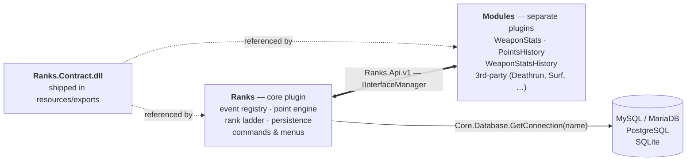

# Ranks — Functional Requirements

| | |
|---|---|
| **Status** | Draft v0.2 — one question open (Q3c leaderboard half, deferred to v1.1); two engine facts need live verification |
| **Plugin id** | `Ranks` |
| **Framework** | SwiftlyS2 (`SwiftlyS2.CS2` `*-*` — newest, prereleases included; .NET 10) |
| **Author** | Shmitzas |
| **Supersedes** | Nothing. This is a clean-room rewrite informed by `K4-LevelRanks`, not a fork of it. |

**This document is the authority on *what* and *why*.**
[`implementation-guide.md`](./implementation-guide.md) covers *how*, against the
framework version the `*-*` reference resolves.
`.github/copilot-instructions.md` covers framework
rules for any work in this repo. Where this file states a requirement and the
guide states a mechanism, this file wins.

### Contents

| § | | § | |
|---|---|---|---|
| [1](#1-purpose) | Purpose | [9](#9-commands-and-menus) | Commands and menus |
| [2](#2-scope) | Scope | [10](#10-modules) | Modules |
| [3](#3-glossary) | Glossary | [11](#11-shared-api-ranksapiv1) | Shared API |
| [4](#4-system-overview) | System overview | [12](#12-non-functional-requirements) | Non-functional |
| [5](#5-persistence) | Persistence | [13](#13-configuration-summary) | Configuration summary |
| [6](#6-points-and-events) | Points and events | [14](#14-open-questions) | Open questions |
| [7](#7-ranks) | Ranks | [15](#15-acceptance-criteria-for-v1) | Acceptance criteria |
| [8](#8-scoreboard-integration) | Scoreboard | | |

---

## 1. Purpose

`Ranks` is the official SwiftlyS2 point-based progression and statistics system
for Counter-Strike 2. It awards points for in-game actions, maps accumulated
points onto a configurable rank ladder, persists per-player statistics, and
exposes all of that to other plugins through a shared API.

**The design rule that shapes everything else: the dependency runs one way.**
Core is a complete, standalone plugin that behaves identically whether zero
modules or ten are installed. It never calls module code, never holds a
module-supplied delegate, and never gains a config key because something was
installed. Modules depend on core; core does not know they exist.

Extensibility therefore comes from core publishing **facts and operations** —
read a record, change points, persist, observe, read the operator's settings —
and modules composing on top of them. A module that wants different scoring
ships its own numbers rather than injecting them into core's.

---

## 2. Scope

### 2.1 In scope

- Core point/rank engine and its persistence.
- Chat and menu surfaces for players and admins.
- Scoreboard integration (clan tag, score sync, Premier rating / skill-group icon).
- A public contract assembly (`Ranks.Api.v1`) covering player data, scoring,
  statistics, leaderboards, lifecycle events, core's point settings, database
  coordination and a module base class.
- Official sibling module plugins: **WeaponStats**, **PointsHistory**,
  **WeaponStatsHistory**, the rating module **Ranks_EloPoints** (FR-MOD-05) and
  the combo module **Ranks_CustomCombos** (FR-MOD-06).


### 2.2 Out of scope

- **Migration from legacy LVL Ranks / K4-LevelRanks schemas.** A clean-break
  schema is a deliberate decision (§5). Migration is handled by a separate
  tool/repo that rewrites a SQL dump offline; `Ranks` ships no importer and
  reads no legacy table.
- **Playtime as a scored or displayed statistic.** The `Ranks` plugin
  description's "playtime data collection" refers to data collected *during*
  play (weapon stats, point history), not to a tracked session-time value.
  No `playtime` column, no `!mytime` / `!ttop` commands.
- Web front-ends, Discord integrations, REST APIs.
- The **RevealAllRanks** module, which is community-maintained (§10).

---

## 3. Glossary

| Term | Meaning |
|---|---|
| **Event** | A named, scorable occurrence (`kill`, `deathrun.map_completed`). The unit of extensibility. |
| **Stat** | A named per-player counter (`core.kills`, `deathrun.maps_completed`). May or may not be tied to an event. |
| **Rank** | A named tier on the ladder, entered at a point threshold. |
| **Skill group** | The CS2-native scoreboard rank icon (index 1–18 in Competitive mode). |
| **Module** | A separate SwiftlyS2 plugin that consumes `Ranks.Api.v1`. Not a compile-time feature flag. |
| **Core event** | A built-in event shipped by `Ranks` itself, namespaced `core.`. |
| **Gate** | A condition that suppresses scoring (warmup, too few players, bot victim). |

---

## 4. System overview



Modules are **ordinary plugins**, loaded and unloaded independently. They own
their own tables, configs, commands and translations. `Ranks` must function
fully with zero modules installed.

---

## 5. Persistence

### FR-DB-01 — Supported engines

MySQL/MariaDB, PostgreSQL and SQLite must all be supported, through
`Core.Database.GetConnection(name)`.

> **Engine dispatch must key on `Core.Database.GetConnectionInfo(name).Driver`
> (`"mysql"` / `"postgresql"` / `"sqlite"`), never on the CLR type of the
> returned `IDbConnection`.** SwiftlyS2 constructs SQLite connections from
> `System.Data.SQLite`, so a `switch` on `Microsoft.Data.Sqlite.SqliteConnection`
> silently never matches and falls through to the default branch. This exact bug
> shipped in K4-LevelRanks and broke every fresh SQLite install.

### FR-DB-02 — Connection selection

`Database.Connection` (default `"default"`) names a connection defined in
SwiftlyS2's global `configs/database.jsonc`. The default matches the entry a
stock SwiftlyS2 install already ships, so `Ranks` works on a fresh server with
no database configuration of its own. `Ranks` never holds its own credentials.

**A connection core cannot open is a fatal startup error.** Core opens it once
at boot and, on failure, throws naming the configured connection and does not
load. An unreachable host, wrong credentials or a missing database is a
misconfiguration for the operator to fix, not a condition to degrade around.

**Core does not police which database the operator pointed it at.** The
framework substitutes the default connection for a name it cannot find — all
three accessors document it — and that substitution cannot be reliably told
apart from an entry that legitimately matches the default. Core therefore logs
the resolved driver, host and database once at boot (implementation-guide §4.1)
and leaves the judgement with the operator, who owns the file.

### FR-DB-03 — Table prefix and suffix

Table names are configurable so several game modes can share one database. Two
independent settings, **both empty by default**:

| `Database.TablePrefix` | `Database.TableSuffix` | Result for base name `ranks_players` |
|---|---|---|
| `""` | `""` | `ranks_players` |
| `"awp"` | `""` | `awp_ranks_players` |
| `""` | `"awp"` | `ranks_players_awp` |
| `"awp"` | `"2v2"` | `awp_ranks_players_2v2` |

- Both may be set at once; there is no mode switch and no mutual exclusion.
- **The separator is supplied by the plugin, not the operator.** `TablePrefix`
  is normalised to exactly one trailing `_` and `TableSuffix` to exactly one
  leading `_`, so `"awp"`, `"awp_"` and `"_awp"` all produce the same name.
  This closes the likeliest trap: an operator who sets `"awp"`, accumulates data
  in `awpranks_players`, then later "fixes" the value to `"awp_"` would
  otherwise be silently pointed at a fresh, empty table set — indistinguishable
  from every player having vanished. Normalising makes that edit a no-op.
- Values must match `^[A-Za-z0-9_]*$`. These become SQL identifiers, so anything
  else **throws at load** rather than being escaped or stripped.
- All affixing goes through one resolver. Every table, index and migration
  version table routes through it — including tables owned by modules, which
  obtain names via `IRanksApi.ResolveTableName` (FR-API-06).
- Changing either value points the server at a different table set. It requires
  a restart (NFR-08) and migrates nothing.

### FR-DB-04 — Core schema

**Two tables, both fixed columns.** Core owns a known, closed set; a module that
needs to store anything owns its own table (FR-API-06), migrated by its own
runner (FR-DB-05). There is no key/value stat table and no mechanism for a
module to add a column to a core table — core's writer is a fixed statement, and
keeping it that way is what makes FR-DB-06's single-statement upsert portable.

**`ranks_players`** — one row per player.

| Column | Type | Notes |
|---|---|---|
| `steam_id` | `BIGINT UNSIGNED` | **PK.** SteamID64, never a rendered `STEAM_x:y:z` string. |
| `name` | `VARCHAR(128)` | Last known name. utf8mb4 on MySQL. Required by `!top`. |
| `points` | `INT` | |
| `kills` | `INT` | **Enemy kills only.** A team kill is its own event (`team_kill`) and does not increment this. Counting it would make `!top kills` farmable by killing teammates. |
| `deaths` | `INT` | **Every death**, whatever killed the player — enemy, teammate, world or their own hand. A death is not farmable, and excluding any source would make the figure disagree with the scoreboard. |
| `assists` | `INT` | |
| `headshots` | `INT` | Enemy kills that were headshots, so it is a subset of `kills` and gated identically. |
| `hits` | `INT` | Shots that damaged someone. **Not** shots: one shotgun blast lands up to nine. |
| `misses` | `INT` | Trigger pulls that damaged nobody. **Never `shots - hits`** — that goes negative on a shotgun. Resolved by a per-player latch, so a grenade whose damage lands after the next shot is attributed to that shot. |
| `round_wins` | `INT` | |
| `round_losses` | `INT` | |
| `match_wins` | `INT` | |
| `match_losses` | `INT` | |
| `bombs_planted` | `INT` | |
| `bombs_defused` | `INT` | |
| `first_seen` | `DATETIME` | |
| `last_seen` | `DATETIME` | Purge key (FR-DB-08). Indexed. |

**`ranks_settings`** — per-player preferences. Fixed columns for the same reason:
a module's own toggle belongs in the module's own table.

| Column | Type | Notes |
|---|---|---|
| `steam_id` | `BIGINT UNSIGNED` | **PK** |
| `show_point_messages` | `BOOL` | The **Settings → XP messages** toggle (FR-PTS-08). Default true. |

A new core preference is a new column and a new migration. That is deliberate —
core's preference set is small and known, and a key/value table here would exist
only to serve modules that now own their own storage anyway.

> [!WARNING]
> No column or table may be named `rank` — it is reserved in MySQL 8.

### FR-DB-05 — Schema versioning and migrations

The schema **will** change across releases — tables added, columns added or
reshaped, obsolete tables dropped. Versioned migrations are therefore required
from v1, not retrofitted once the first breaking change arrives.

**Tool: FluentMigrator**, with `FluentMigrator.Runner.MySql`, `.Postgres` and
`.SQLite`.

#### The version ledger

**One connection, one ledger per plugin — and one runner, owned by core.** Core
and every module share the connection named by `Database.Connection`
(FR-DB-02) — one credential set for the operator to configure, and modules can
`JOIN` core's tables. A module does **not** run its own FluentMigrator runner:
it registers its migration assembly with core (FR-API-06) and core runs it,
against a ledger core derives.

> **Why core owns the runner.** Affix application is the whole point of
> FR-DB-03, and a module that writes `Create.Table("weapon_stats")` produces an
> unprefixed table on a prefixed server. FluentMigrator offers no table-name
> convention to intercept this — `IConventionSet` governs constraint, index,
> foreign-key, primary-key, schema and script names, and nothing else — so the
> only enforcement point is the runner itself. While each module owned its own
> runner, every helper core could offer was opt-in, which is a convention, not a
> guarantee. Core-owned runners also resolve a timing contradiction: a module's
> `Load()` runs *before* the shared-interface handshake, so it never had an
> `IRanksApi` to ask for a table name at the moment it supposedly needed one.

- Core's ledger is `ranks_migrations`. A module's is derived from its plugin id
  by the rule below — never chosen, and no longer the module's concern.
- **The ledger must carry the configured prefix/suffix (FR-DB-03).** This is the
  highest-consequence mistake in this section. **A ledger is scoped to the table
  set it tracks** — `awp_ranks_players` and `dm_ranks_players` are different
  tables, so "migration X applied" means nothing unless the record says *applied
  to which set*. If the ledger is not affixed: server A (prefix
  `awp`) boots first, records every migration and creates `awp_ranks_players`;
  server B (prefix `dm`) then boots, `MigrateUp()` sees everything already
  applied, does nothing, and `dm_ranks_players` is **never created**. Every
  subsequent query fails.
- Supply it through `IVersionTableMetaData`. `DefaultVersionTableMetaData`
  cannot be cheaply subclassed in FluentMigrator 8.x — its only constructor is
  `(IConventionSet, IOptions<RunnerOptions>)` — so implement the eight get-only
  properties directly.
- **The ledger's unique index name must be derived from the ledger name too.**
  The stock value is the constant `UC_Version`. Index names are per-table on
  MySQL but **per-schema on PostgreSQL and database-wide on SQLite**, so with
  one ledger per plugin the second plugin to migrate fails outright on two of
  the three supported engines. Mechanics in implementation-guide §4.5.

> **Why not one shared ledger.** The official `SwiftlyS2-Plugins/Admins` does
> exactly that: `Admins.Core`, `Admins.Bans` and `Admins.Comms` each run their
> own runner against one `"admins"` connection and the stock `VersionInfo`
> table. It works — but only because the migration IDs were hand-coordinated
> into a single sequence (`…20270214103911` through `…103918`) across three
> module folders. That is a hidden coupling between separately-shipped plugins,
> and it has two reachable failure modes, both silent:
>
> 1. **A third-party module picks a colliding ID.** If the other plugin booted
>    first, the ID is already in the ledger, `MigrateUp()` applies nothing, and
>    the module's table is never created. No exception, no log line.
> 2. **An operator drops a module's tables and reinstalls it.** The ledger still
>    records them as applied, so they never come back.
>
> A per-plugin ledger removes both by construction and costs one small table per
> module. Load order is *not* the reason — with unique IDs a shared ledger is
> order-independent, and claiming otherwise would be wrong.

#### Ledger naming

The ledger name is mechanical so two modules cannot collide: lowercase the
plugin id, collapse every non-alphanumeric run to `_`, strip a leading `ranks_`,
prepend `ranks_migrations_`, then apply the FR-DB-03 affixes.
`Ranks_WeaponStats` → `ranks_migrations_weaponstats`. SwiftlyS2 plugin ids are
already unique per host, so the output is too.

> **The input is the `[PluginMetadata] Id`, never the folder name.** They match
> by convention — modules are named `Ranks_<Name>` throughout — but the rule
> reads the id, so a module that diverges still gets a correct ledger.

**Mind the identifier length limit.** MySQL allows 64 characters and PostgreSQL
**63 — and PostgreSQL truncates silently rather than erroring**, so a long
prefix plus a long plugin id could quietly map two modules onto one ledger,
which is the exact failure this design exists to prevent. Core must detect the
overflow and fold the tail into a short deterministic hash rather than letting
the engine cut it.

**Apply that cap to the ledger's index name as well, and independently.** The
index name is the ledger name plus a fixed affix of its own, so it overflows
first — a ledger that fits in 63 characters can still derive an index that does
not. Capping only the table name leaves the real overflow unhandled.

#### Required behaviour

| # | Requirement | Consequence if missed |
|---|---|---|
| 1 | Version numbers are `YYYYMMDDHHmm`, assigned once, never reused or renumbered | the ledger stores the number, not the file |
| 2 | Every migration guards **each object individually**, never the migration as a whole | the rest is skipped yet still recorded as applied — permanent, surfaces later as "table doesn't exist" on every connect |
| 3 | …except `Create.PrimaryKey`, which must not be guarded that way | MySQL names every PK `PRIMARY`, so the check is always false and `ADD CONSTRAINT` then fails |
| 4 | Index and constraint names carry the affixes too | works on MySQL, collides on PostgreSQL and SQLite |
| 5 | Database identifiers are checked against a real alias list | `IfDatabase("Postgres")` matches nothing, silently |
| 6 | `Down()` exists but never drops a table holding player data | downgrade is not a supported operation |
| 7 | The same logical schema is produced on all three engines, verified fresh **and** against an existing database | `MigrateUp()` aborts at the first failure, so a green MySQL run says nothing about SQLite |
| 8 | A migration failure does **not** disable a working database | shared hosting commonly grants DML but not DDL; the plugin must run degraded rather than not at all |
| 9 | One module's migration failure does not affect core or any other module | core now runs them, so an unhandled throw would take the whole schema down with it |
| 10 | Table names in registered migrations are rewritten with the FR-DB-03 affixes by core | the enforcement this design exists for |

Requirement 8 is the one with a shape rather than a rule: run migrations, keep
the exception, then probe `SELECT 1 FROM {table} WHERE 1 = 0` **unconditionally**
and decide from the probe. That is what turns "an exception on every player
connect" into one line at boot.

> **Requirement 10 has one unavoidable gap: `Execute.Sql`.** Raw SQL carries no
> expression tree, so no rewriting can reach inside it. A module issuing
> `Execute.Sql("CREATE TABLE weapon_stats …")` escapes the affixes entirely.
> Core therefore **verifies** after migrating a module: any table the module
> created that does not carry the expected affixes is logged at `Error` naming
> the module. Enforcement for the expression API, detection for the rest.

> **Mechanics live in the implementation guide**, §4.5–4.6: engine registration
> and the alias table, the `IVersionTableMetaData` implementation, SQLite's
> `ALTER COLUMN` limitation, runner lifecycle, and the permission-error codes to
> recognise per engine.

### FR-DB-06 — Write semantics

- Writes are **absolute** (the in-memory record is authoritative and overwrites
  the row), not additive deltas. History and diffing are the PointsHistory
  module's job, not the core writer's.
- Every upsert is a **single statement** against a real PK/unique constraint —
  `ON DUPLICATE KEY UPDATE` on MySQL/MariaDB, `ON CONFLICT … DO UPDATE` on
  PostgreSQL/SQLite. "`UPDATE`, then `INSERT` on zero rows affected, catch
  duplicate-key" is not portable: a failed statement aborts the surrounding
  PostgreSQL transaction.
- A record is marked saved **only after the write commits.** A failed save is
  retried with the then-latest values.
- Each player is isolated behind a savepoint. One bad row (e.g. an unencodable
  name) must skip that player, not abort the batch — otherwise one corrupt
  record stops the whole server from saving.

### FR-DB-07 — Load and save triggers

| Trigger | Behaviour |
|---|---|
| Player authorized | Load record (all tables, one round trip). Driven by the **`OnClientSteamAuthorize` core event**, not by connect and not by polling `IPlayer.IsAuthorized`: before Steam authorization the real SteamID is not yet available (`IPlayer.UnauthorizedSteamID` holds the provisional value), so loading on connect keys the record to the wrong id. |
| Authorization fails | `OnClientSteamAuthorizeFail`. The player is **never tracked** and earns nothing for the session. Logged at **`Warning`, ungated** — a player silently not being tracked is indistinguishable from a bug, so this is the only signal anyone gets. |
| Load fails | Player is **not** tracked, and the load is retried. Never substitute a fresh empty record — the next absolute save would wipe the real row. |
| Periodic | Save pass on a configurable interval (`Database.SaveIntervalSeconds`, default `300`). |
| Round end / map end | Save pass. |
| Player disconnects | Record stays resident until fully saved; a reconnect adopts it. The disconnect handler must not gate on pawn validity. |
| Plugin unload | Blocking flush with a bounded budget (~8 s). |

**Fake clients are never tracked and never get a row.** The filter is
`IPlayer.IsFakeClient`, applied at load, and it is independent of
`Rank.BotsEnabled` — that gate decides whether a *human* earns points from a
bot kill, not whether the bot itself has a record. Bots have no SteamID64, so
persisting them would key every bot on the server to the same value.

**`name` is rewritten on every save**, not fixed at first sight. `!top` renders
offline players from this column, so a stale value makes the ladder look broken
to the one person most likely to notice. It is the only column whose value comes
from the player rather than from play, which is also why FR-DB-06's per-player
savepoint matters: an unencodable name must skip that one record.

### FR-DB-08 — Purge

`Database.PurgeDays` (default `0` = never) deletes `ranks_players` rows whose
`last_seen` is older than the threshold, cascading to `ranks_settings`. Runs as
part of the maintenance pass (FR-DB-09).

**Modules must be told.** A purge that sweeps only core's two tables leaves
`ranks_weapon_stats`, `ranks_points_history` and every third-party table holding
rows for players that no longer exist — they are keyed on SteamID64, nothing
joins them back to core, and no later pass will ever collect them. Core raises
`PlayersPurged` (FR-API-04) with the purged SteamIDs so a module can sweep its
own tables in the same pass. LVL Ranks exposes `OnDatabaseCleanup` for exactly
this reason.

### FR-DB-09 — When heavy work runs

Purges, history roll-ups and any other bulk pass run **when no players can feel
them**. Three rules, in order of how often they fire:

| Trigger | Runs? |
|---|---|
| `Load(hotReload: false)` | **Yes** — server startup, empty by definition |
| `Load(hotReload: true)` | **No** — see below |
| Interval elapsed **and** server empty | Yes, only when opted in |

**The `hotReload` skip is the load-bearing one.** A hot reload is how an operator
deploys a fix mid-session, so players *are* connected. Migrations may still run
there — they are guarded and cost one metadata query once applied — but a purge
or a month's roll-up is not a no-op and must not freeze a live server.

**`Database.MaintenanceIntervalHours`** (default `0` = load-only) covers servers
that are never restarted. Non-zero enables a single check at round end: if the
interval has elapsed since the last pass **and** the server is empty, run again.
Default `0` is correct for the large majority, which restart daily or every few
hours.

> **The elapsed-time marker is in memory, not in the database.** A pass always
> runs at load, so a persisted timestamp could only ever suppress a run that is
> already the default behaviour — it would buy nothing and cost a column, a
> migration and a write. The field resets on restart, which is exactly right.

> **Roll-up before prune, in the same pass.** Reversed, a period is pruned before
> it has been folded into the next tier and the history is silently wrong — the
> rows are gone and nothing reports a gap. This is the ordering rule for any
> module implementing FR-MOD-02 / FR-MOD-03 as well as for core's own purge.

---

## 6. Points and events

### FR-PTS-00 — Core ranking logic toggle

`Rank.UseCoreRankingLogic` (default `true`) decides whether core's scoring runs
at all.

| | `true` (default) | `false` |
|---|---|---|
| Core's own handlers award points | yes | **no** |
| Core's gates, multipliers and dynamic kill/death scaling | applied to core's awards | **inert — nothing in core computes a multiplier** |
| Core tracks stat counters (kills, deaths, assists, round wins, bombs, …) | yes | **yes** |
| `AddPoints` / `SetPoints` from a module | stored **raw** | stored **raw** |
| Core's point settings readable through the API | yes | yes |
| Ladder, scoreboard, commands, menus, persistence, API | active | active |

Switching it off turns `Ranks` into a **host**. It still owns the record cache,
the schema and writer, the rank ladder, the scoreboard, the commands and menus
and the whole API — it simply stops deciding what a kill is worth. A rating
module (FR-MOD-05) becomes the scoring authority and writes the value with
`SetPoints`.

**Everything downstream of a point value is muted with it.** Gates, the VIP
multiplier and dynamic kill/death scaling exist to shape *core's* awards; with
core not awarding they have nothing to act on, so core computes no multiplier
and applies no gate. They do not quietly keep running against module writes.

**But the settings stay readable.** Core publishes every point-related setting
through the API (FR-API-05) in both modes, so a rating module can honour the
operator's configured VIP multiplier and dynamic bounds inside its own formula
instead of making the operator configure the same intent twice. Core exposes
the values as facts; what a module does with them is the module's business.

**`AddPoints` is always raw, in either mode.** It deposits an already-computed
number. Core does not gate it, multiply it or scale it — an additive module that
wants VIP-multiplied bonuses reads `VipMultiplier` from the settings API and
applies it itself. This is what makes additive modules composable: the number a
module hands over is the number that lands, so two of them can never interact
through a shared multiplier stage.

**A module replaces core's scoring; it never extends it.** There is no blended
mode and no hook that lets a module adjust what core awards. A module that
wants its own scoring subscribes to the game events itself, computes the value
under its own model, and calls core to persist it. Core contributes nothing to
that number. The practical consequence is that a module cannot be "core's rules
plus one bonus" — if it owns scoring it owns all of it, which is what keeps a
single writer on the `points` column.

**Stat tracking is deliberately not disabled with it.** `!stats`, the
leaderboards, the WeaponStats module and the rating modules themselves all read
those counters, and a rating module should not have to re-implement kill/death
tracking merely because it owns the points. Points and statistics are
separable; only points are switched off here.

A `false` setting with no rating module installed leaves nobody awarding points,
which looks exactly like a broken plugin. Core logs one `Warning` at
`OnAllPluginsLoaded` naming the setting — unconditionally, because core has no
registry of who is scoring and deliberately does not acquire one.

> **Absolute writers must be exclusive. Additive writers compose.**
>
> `SetPoints` is absolute — it replaces whatever was there, so two plugins doing
> it fight and the last one at any instant wins. Exactly one absolute authority
> may be active: `Ranks` core, or one rating module (FR-MOD-05), never two, and
> never a rating module with `UseCoreRankingLogic` left `true`. This is an
> **operator constraint stated in the documentation**, not something core
> engineers around — core cannot detect the combination without tracking who is
> scoring, which would invert the dependency.
>
> `AddPoints` is relative and cannot lose anyone's work in either order, so
> additive modules — `Ranks_CustomCombos` (FR-MOD-06) is the reference case —
> coexist freely with whichever authority is active, and with each other. That
> holds for `Ranks_CustomCombos` in its default mode; with `SuppressCoreAwards`
> on it is deciding the award rather than adding to one, and stops being safe to
> pair with an absolute authority.
>
> This is the rule that tells a module author which kind they are building.

### FR-PTS-01 — Core's catalogue is fixed and closed

Core scores a **known, closed set of events** (FR-PTS-06), priced in
`points.jsonc`. It is not extensible: there is no registry, no module-supplied
event key, and nothing a module can add to core's config surface.

This is the dependency rule applied to scoring. Core must not know which modules
exist, and a registry would mean core's own config file changes shape depending
on what is installed. A module that wants to score something core does not — a
Deathrun map completion, a surf record — observes the event itself, prices it in
**its own** config, and calls `AddPoints`. The operator tunes it in the plugin
that owns the feature.

> **Risk — game events are a deprecated Source 2 feature.** The stable
> SwiftlyS2 *Game Events* guide opens with it: *"Game events are a legacy
> Source 2 mechanism and Valve has been retiring them over time — some events no
> longer fire in current CS2 builds. Prefer Game Hooks or Core Events when an
> equivalent exists."* Core scoring is built almost entirely on them, so the
> catalogue in FR-PTS-06 is a statement of intent, not of verified availability.
>
> Each event must be confirmed to fire on a live server before its points value
> is treated as reachable. Where one does not, the replacement is a
> `Core.GameHooks.*` category or a core event rather than a workaround — the
> same guide maps the retired hook-style events onto their replacements
> (`OnEntityTakeDamage` → `Core.GameHooks.Entities.TakeDamage`, and so on).
>
> **This is the single largest unvalidated assumption in the document.** It is
> not a reason to redesign around hooks pre-emptively — game events remain the
> cheapest correct source for the ones that do fire — but shipping a catalogue
> without that pass means shipping config keys that silently never pay out.

### FR-PTS-02 — Awarding

Core's internal award path, driven by its own event handlers. It is not public
API — a module reaches `AddPoints` / `SetPoints` instead (FR-API-02).

Resolution order for a single award:

1. Look up the configured point value for the event.
2. Apply gates (FR-PTS-03).
3. Multiply by the occurrence count.
4. Apply core's multipliers (FR-PTS-04).
5. Round once, at the end, **away from zero** — never round per-stage.
   Away-from-zero is what stops a small-but-nonzero award silently becoming `0`;
   a death penalty that rounds to nothing is a free death.
6. Apply to the in-memory record.
7. Emit the chat line, or buffer it for the round-end summary.

A configured value of `0` disables the event, including its chat line, but
**not** its stat increment.

### FR-PTS-03 — Gates

| Gate | Setting | Default |
|---|---|---|
| Minimum players on the server | `Rank.MinPlayers` | `4` |
| Warmup | `Rank.WarmupPoints` | `false` (no points during warmup) |
| Bot victim/actor | `Rank.BotsEnabled` | `false` |
| FFA mode (suppresses team-damage penalties) | `Rank.FfaMode` | `false` |

**`MinPlayers` and `FfaMode` suppress the award, never the stat increment.
`WarmupPoints` and `BotsEnabled` discard the death event outright.**

`MinPlayers` and `FfaMode` are judgements about when play is worth paying for —
the kills still happened, between real players, so a kill below `MinPlayers`
still counts. That is the same separation FR-PTS-02 states for a configured value
of `0` and FR-PTS-00 for `UseCoreRankingLogic = false`: points are a judgement,
counters are facts.

`WarmupPoints` and `BotsEnabled` are different in kind. They do not ask whether
play was worth paying for, they ask whether this was play at all — a warmup round
is not the match, and a bot is not a player. With either `false`, the matching
`player_death` is dropped before anything derives from it: no `kills`, `deaths` or
`assists`, no killstreak, and no `IRanksKillArbiter` claim (FR-API-11).

> [!NOTE]
> This reverses the earlier rule, under which both suppressed only the award. That
> version was unsound: `AwardKillstreak` has no counterparty to pass, so the bot gate
> in `PassesGates` never saw one and **killstreak tiers paid out against bots** on any
> server that left them in — `streak.godlike` is 15 points, farmable against AI.
> Gating each award site individually cannot fix that, because a streak is a property
> of the round rather than of one kill; only dropping the event can.

Both gate the three counterparty counters and everything downstream of the death.
`round_wins`, `round_losses`, `match_wins`, `match_losses`, `bombs_planted` and
`bombs_defused` come from other events and are unaffected — warmup rounds that end
still move the round counters.

> **Consequence for `SUM(WeaponStats.kills)`.** The bot half reconciles by
> construction: `Ranks_WeaponStats` carries no bot switch and reads `BotsEnabled`
> through the API, so the two sides cannot be configured into disagreeing. **The
> warmup half does not**: `Ranks_WeaponStats` has no warmup gate, so with
> `WarmupPoints` off it records warmup kills that core now discards, and its total
> runs ahead on any server with warmup enabled.

Gate state must be readable from the API (FR-API-05) so a module can skip
expensive work it knows will be discarded.

### FR-PTS-04 — Core's multipliers

Core applies exactly two multipliers to its **own** awards, both fixed and
built in. There is no registration hook: a module cannot inject a multiplier,
because that would have core calling out to module code mid-award.

| Multiplier | Applies to | Setting |
|---|---|---|
| **VIP** | every core award | `Vip.Multiplier` (default `1.25`) when the player holds any flag in `Vip.Flags` (default `["@ranks/vip"]`) |
| **Dynamic kill / death** | `kill` and `death` only | FR-PTS-05, each under its own toggle |

They are multiplied together, then the result is rounded once (FR-PTS-02 step 5).

> **`Vip.Flags` defaults to a namespaced flag nobody holds yet**, rather than to
> an empty list. Empty is indistinguishable from a broken config and makes the
> feature invisible; `@ranks/vip` documents the expected shape, cannot collide
> with another plugin's grants, and still awards nothing until an operator
> grants it — discoverable and fail-closed at the same time.

**Both are inert when `UseCoreRankingLogic` is `false`** (FR-PTS-00), and
neither ever applies to `AddPoints` or `SetPoints`.

> **A module that wants a multiplier applies it itself.** A double-XP weekend
> plugin computes its own value and calls `AddPoints`; a rating module reads
> `VipMultiplier` and the dynamic bounds from FR-API-05 and folds them into its
> own formula. Core publishes the settings as facts — it does not run a pipeline
> on anyone else's behalf.
>
> Where a module genuinely needs to influence a value core is *about* to write,
> the mechanism is the `PointsChanging` event (FR-API-04): core raises it to
> anonymous subscribers and honours a mutated amount. Core still does not know
> who is listening.

### FR-PTS-05 — Dynamic kill and death points

Dying to a much weaker player should hurt more; dying to a much stronger player
should hurt less. Killing a much stronger player should pay more; killing a much
weaker one should pay less. Without this, a top player and a brand-new player
pay exactly the same price for a death and earn exactly the same for a kill,
which makes the top of the ladder cheap to hold.

Both sides run the **same formula over the same ratio** and differ only in which
event they scale and which bounds they read.

| Setting | Default | Meaning |
|---|---|---|
| `Points.DynamicDeathPoints` | `true` | Enable toggle for the death side |
| `Points.DynamicDeathMin` | `0.5` | Death multiplier when the victim is as weak as possible relative to the attacker |
| `Points.DynamicDeathMax` | `3.0` | Death multiplier when the victim is as strong as possible relative to the attacker |
| `Points.DynamicKillPoints` | `true` | Enable toggle for the kill side |
| `Points.DynamicKillMin` | `0.5` | Kill multiplier when the victim is as weak as possible relative to the attacker |
| `Points.DynamicKillMax` | `3.0` | Kill multiplier when the victim is as strong as possible relative to the attacker |

**Scope: the victim's `death` deduction and the attacker's `kill`
reward.** Each is gated by its own toggle and reads its own bounds, so a server
may scale one, both or neither.

#### Formula

Let `Pv` be the victim's points and `Pa` the attacker's, both read **before**
this kill is applied.

```
d = (Pv - Pa) / max(Pv, Pa)        // relative difference, in [-1, +1]
                                   // both zero -> d = 0

multiplier = d >= 0
           ? 1 + d * (Max - 1)     // victim stronger -> punish / reward more
           : 1 + d * (1 - Min)     // victim weaker   -> punish / reward less
```

**`d` is always `(victim - attacker)`, on both sides.** It is a property of the
matchup, not of whose points are changing. The death side reads it from the
victim's perspective and the kill side from the attacker's, but the value is
identical for one kill — which is what makes the two halves one mechanism rather
than two. `Max` and `Min` resolve to the `DynamicDeath*` or `DynamicKill*` pair
depending on the event being scaled.

Anchors — these are the properties to hold on to. Both columns use the shipped
`0.5` / `3.0` bounds, so they coincide; they diverge as soon as the two pairs are
tuned apart:

| Situation | `d` | Death × | Kill × |
|---|---|---|---|
| Equal points | `0` | `1.00` | `1.00` — configured value applies **as-is** |
| Victim 1000, attacker 900 | `+0.10` | `1.20` | `1.20` |
| Victim 1000, attacker 100 | `+0.90` | `2.80` | `2.80` |
| Victim 100, attacker 1000 | `−0.90` | `0.55` | `0.55` |
| Victim on `0`, attacker anything | `−1.00` | `0.50` | `0.50` (= `Min`) |

The curve is continuous and piecewise-linear, with both halves pinned at `1.0`,
so a near-equal matchup is a near-no-op. **That `d = 0 -> 1.0` anchor is the
behaviour the config documents** — any replacement formula must preserve it, or
the configured `kill` and `death` values stop meaning what they say.

#### Why `max(Pv, Pa)` is the denominator

It makes `d` symmetric and bounded in `[-1, +1]` with no second clamp, and it
degrades sanely at the extremes. Dividing by `Pa` alone is the obvious
alternative and is wrong: a victim on 10 000 against an attacker on 1 yields
`d = 9999`, so the curve is dominated entirely by its own clamp and is violently
sensitive whenever the attacker is near zero — which is precisely the
fresh-player case this feature exists to handle.

#### Edge cases

- **No attacker** — suicide, world damage, fall damage, console kill. The death
  multiplier is `1.0` and the configured value applies as-is; there is no
  counterparty to compare against. The kill side does not arise: no attacker
  means no `kill`.
- **Bot counterparty.** Governed by `Rank.BotsEnabled`: when bots score no
  points the event is gated out entirely and the multiplier never runs. When
  they do count, a bot has no record and counts as `0`. On the kill side that
  puts `d = −1`, so **killing a bot pays `DynamicKillMin`** — bot farming
  prices itself at the floor, which is a useful property rather than an
  accident.
- **Both players on `0` points.** `d = 0` -> `1.0`. Two fresh players are equal.
- **Team kill** is its own event (`team_kill`), not `death`, so it is
  unaffected.
- The formula assumes non-negative points, which FR-RNK-04 guarantees.
  `Rank.MinPoints` must therefore stay `>= 0`.

#### Validation

For **each** pair independently: `Min` must be in `(0, 1]` and `Max` must be
`>= 1`. Outside that range the `d = 0 -> 1.0` anchor breaks and an equal-rank
kill or death stops matching the configured value. Out-of-range values are
**clamped at load with a warning** rather than throwing — a bad multiplier is a
tuning error, not a data-loss risk.

> **Consequence worth stating in the config comments: with the kill side on, the
> shipped bounds are a catch-up mechanic.** On a server where most opponents sit
> below you, `d` is negative for most of your kills and the reward trends toward
> `DynamicKillMin` — half rate at the default. That compresses the ladder, which
> is the point, but it also slows the *whole* mid-table and not just the top. An
> operator who wants a pure volume ladder sets `DynamicKillPoints` to `false`;
> one who wants the effect softened raises `DynamicKillMin` toward `1.0`.

### FR-PTS-06 — Core event catalogue

Minimum set shipped under `core.`, all configurable, all disableable by setting
their value to `0`. These are the **flat** events — each fires independently and
they stack. Combinations are not core's (FR-PTS-09); they belong to
`Ranks_CustomCombos` (FR-MOD-06).

**Shipped defaults** — derived from the K4-LevelRanks defaults, which are a known
quantity on live servers, with the three corrections noted below the table.

| Event | Default | Event | Default |
|---|--:|---|--:|
| `kill` | `2` | `bomb_plant` | `10` |
| `death` | `-3` | `bomb_defuse` | `10` |
| `assist` | `1` | `bomb_defuse_others` | `10` |
| `assist_flash` | `1` | `bomb_exploded` | `10` |
| `headshot` | `3` | `bomb_pickup` | `2` |
| `suicide` | `0` | `bomb_drop` | `-2` |
| `team_kill` | `0` | `hostage_rescue` | `10` |
| `team_assist` | `0` | `hostage_rescue_all` | `10` |
| `noscope` | `5` | `hostage_hurt` | `0` |
| `wallbang` | `4` | `hostage_kill` | **`-20`** |
| `through_smoke` | `3` | `round_win` | `2` |
| `blind_kill` | `3` | `round_lose` | `-2` |
| `long_distance` | `3` | `mvp` | `10` |
| `knife_kill` | `5` | `match_win` | **`15`** |
| `taser_kill` | `5` | `match_lose` | **`-5`** |
| `grenade_kill` | `5` | | |
| `inferno_kill` | `5` | | |
| `impact_kill` | `5` | | |

Three deliberate departures from the source config, all bolded above:

1. **`hostage_kill` is `-20`, not `+20`.** The upstream default rewards
   killing a hostage at double the value of rescuing one. That is a sign error,
   not a design choice — `hostage_hurt` sits at `0` right beside it, so the
   intent was clearly a penalty.
2. **`match_win` / `match_lose` have no upstream counterpart**, because
   LVL Ranks models no match. `15` / `-5` is an invention, sized so a match is
   worth roughly a good round's MVP without dominating a session. Revisit once
   FR-PTS-06's deprecation risk on `EventCsWinPanelMatch` is settled on a live
   server — if the panel never fires, both are dead config.
3. **Playtime rewards are absent.** The source config carries
   `PlaytimeMinutes` / `PlaytimePoints`, both `0`. Core awards points for
   actions, not for occupying a slot; a module can award on a timer if an
   operator wants it.

> **`points.jsonc` holds point values and nothing else.** The source config mixes
> two tuning constants into the same block — `LongDistance: 100` is a distance
> threshold and `SecondsBetweenKills: 0` is a streak window, neither of which is
> a number of points. They live in `config.jsonc` as `Points.LongDistanceUnits`
> and `Points.SecondsBetweenKills`. Keeping them separate is what lets
> `points.jsonc` be read as "every key here is worth this many points" with no
> exceptions to remember.
>
> `Points.LongDistanceUnits` **must state its unit in the shipped comment.** The
> upstream `100` is ambiguous and the two readings are far apart: 100 Source
> units is about 2.5 m and would fire on nearly every kill, while 100 m is a
> genuinely long shot. Default `2000` units (~50 m) and say so — **state the
> ratio too (1 unit ≈ 2.54 cm)**, or the next person converts at 1.905 cm,
> computes 38 m, and writes a comment that contradicts this line.

**`match_win` / `match_lose` fire on `EventCsWinPanelMatch` only.** That event's
interface is empty — it carries no winner — so the side is decided by comparing
the two `CCSTeam` entities' `Score` (`ref int`, inherited from `CTeam`) at that
moment, and the recipients are each team's `PlayerControllers`.

- **On a server with no match structure the event never fires and both columns
  stay `0`.** That is the correct answer rather than a gap, and it needs no
  config key to express. The alternative — counting rounds against
  `mp_maxrounds` — means re-implementing rules that differ per gamemode
  (overtime, `mp_match_can_clinch`, custom limits) and being quietly wrong on
  every non-standard one.
- **The roster is whoever is on a team when the panel fires.** A player who
  played twenty rounds and disconnected gets nothing. Crediting them needs a
  match-participation session that core deliberately does not model.
- **A tie awards neither.** There is no `core.match_tie`.
- This pair inherits the deprecation risk noted on FR-PTS-01 more sharply than
  most: confirm the panel event actually fires on a live server before treating
  these two columns as reachable.

### FR-PTS-07 — Killstreaks

Opt-in per-round kill accumulation (`Points.KillStreaksEnabled`, default
`true`). **Eleven tiers**, covering 2 through 12-or-more kills, each a
`streak.*` event so they are tunable like any other.
`Points.SecondsBetweenKills` (`0` = no time limit) bounds the window; streaks
reset on death and, optionally, on round end
(`Points.KillstreakResetOnRoundEnd`).

| Kills | Event | Default | Kills | Event | Default |
|--:|---|--:|--:|---|--:|
| 2 | `streak.double` | `5` | 8 | `streak.ultra` | `11` |
| 3 | `streak.triple` | `6` | 9 | `streak.killing_spree` | `12` |
| 4 | `streak.domination` | `7` | 10 | `streak.monster` | `13` |
| 5 | `streak.rampage` | `8` | 11 | `streak.unstoppable` | `14` |
| 6 | `streak.mega` | `9` | 12+ | `streak.godlike` | `15` |
| 7 | `streak.ownage` | `10` | | | |

Streaks are the one count-based case core keeps, because a streak is a property
of the player's round rather than of any single kill and needs no attribute
vocabulary to express. Core's streaks are weapon-agnostic, and
`Ranks_CustomCombos`'s `Count` is same-tick only (FR-MOD-06) — so a streak
**restricted** to a weapon or a placement, spread over a round, is deliberately
supported by neither. Adding it means either an attribute vocabulary inside core
or a timed window back in the module; both were rejected, and a second killstreak
system inside core is not the answer.

### FR-PTS-08 — Point feedback

| Setting | Behaviour |
|---|---|
| `Points.ShowPointMessages` (default `true`) | Per-action chat lines. |
| `Points.RoundEndSummary` (default `false`) | Buffer per-action lines and emit one aggregated summary at round end instead. |
| Per-player override | The **Settings → XP messages** toggle, persisted in `ranks_settings`. |

### FR-PTS-09 — Combination scoring is a module, not core

The flat catalogue in FR-PTS-06 stacks additively: a knife headshot already
scores `kill` + `headshot` + `knife_kill`. What it cannot express
is a value for the **combination** — "a knife headshot is worth a 50-point
bonus", or "a triple kill with a grenade".

**Core does not gain that vocabulary.** It ships the flat catalogue and nothing
else. Combination scoring is `Ranks_CustomCombos` (FR-MOD-06), which core consults
per kill through FR-API-11 and whose claim core awards through its own pipeline.

The split is deliberate rather than a scoping convenience:

- The module needs **nothing from core** to do it. SwiftlyS2 hands any plugin
  `EventPlayerDeath` directly, so a matcher inside core would only be re-reading
  fields the module can already see for itself.
- A match vocabulary is the one part of scoring that genuinely wants to keep
  growing — new attributes, counts, time windows. Growing it inside core makes
  every addition a core release and a config-schema change for every server that
  does not use combos.
- Core's model stays describable in one sentence: every scorable action is an
  event with a number, and they stack. That sentence is worth protecting.

---

## 7. Ranks

### FR-RNK-01 — Ladder

`ranks.jsonc` holds an ordered list. A player's rank is the highest entry whose
`Points` threshold they meet.

| Field | Notes |
|---|---|
| `Name` | Display name |
| `Tag` | Short form for the clan tag |
| `Color` | Chat colour token |
| `Hex` | Colour for menu rendering |
| `Points` | Threshold (inclusive) |
| `SkillGroup` | Competitive skill-group index, see FR-SCB-03 |

The first entry must have `Points: 0`; load fails loudly otherwise, since a
player below the lowest threshold would have no rank at all.

**Thresholds are fixed point values. There is no percentile or position mode**
— see Q12. The consequence is worth stating in the shipped config's comments
rather than discovering later: `points` is cumulative with no decay (Q15), so
any fixed ladder saturates as a server ages. Give it long enough and every
regular sits above the top threshold, and the upper ranks stop distinguishing
anyone. Re-tuning the ladder is the remedy, and it necessarily demotes players
who have not lost any points — so it is a decision to take deliberately, not a
routine maintenance task.

**Core ships the seven CS2 Premier bands.** Shipping an empty ladder would leave
`!rank` with nothing to print and the scoreboard with nothing to show on first
start, which relocates the opinion to whoever posts a ladder first rather than
removing it.

| # | Name | Tag | Points | Colour | Hex | SkillGroup |
|--:|---|---|--:|---|---|--:|
| 1 | Grey | `Grey` | `0` | `grey` | `#B0C3D9` | `1` |
| 2 | Light Blue | `LtBlue` | `5000` | `lightblue` | `#5E98D9` | `4` |
| 3 | Blue | `Blue` | `10000` | `blue` | `#4B69FF` | `7` |
| 4 | Purple | `Purple` | `15000` | `purple` | `#8847FF` | `10` |
| 5 | Pink | `Pink` | `20000` | `magenta` | `#D32CE6` | `13` |
| 6 | Red | `Red` | `25000` | `red` | `#EB4B4B` | `16` |
| 7 | Gold | `Gold` | `30000` | `gold` | `#CAAB05` | `18` |

Thresholds and colours are CS2's own Premier bands verbatim, so a player who
knows Premier already knows this ladder. The hexes are the familiar
CS:GO rarity palette, which Valve reuses for the rating bands.

> **Seven coarse bands work here only because Premier mode shows the number.**
> At the shipped point values an average regular earns roughly 190 points/hour
> (see below), so a band lasts about 26 hours — far too long to feel like
> progress on its own. In Premier mode the scoreboard renders the rating itself
> (FR-SCB-03), which moves every round, and `!rank` reports the distance to the
> next band. The colour is the tier; the number is the progress bar. **Switching
> `Scoreboard.RankMode` to Competitive without also switching to a
> finer-grained ladder removes the number and leaves only seven icons** — which
> is why the 18-entry competitive ladder ships as an example file.

Alternative shapes ship under `resources/examples/` as files an operator copies
over `ranks.jsonc`: an **18-entry competitive ladder** matching the CS2 skill
groups 1:1 (the right partner for `RankMode: Competitive`), a 15-entry Danger
Zone ladder, and a 10-entry Faceit one. No preset command, no preset registry,
no "which preset am I on" state: copying a file is already the whole operation.

#### What the thresholds cost in hours

At the FR-PTS-06 defaults, a 30-minute map for a mid-table player on a public
server works out near `+94` — 25 kills, 20 deaths, 10 headshots, 5 assists, even
round win/loss, 2 MVPs, a couple of bomb events and a few short streaks. That is
**~190 points/hour**, so Gold is roughly **158 hours** of play.

The spread matters more than the average, because `kill` (`2`) is smaller
than `death` (`-3`):

| Player | Net per map | Per hour | Hours to Gold |
|---|--:|--:|--:|
| ~0.8 K/D | ~`+4` | ~`8` | effectively never |
| ~1.25 K/D | ~`+94` | ~`190` | ~158 |
| ~1.8 K/D | ~`+168` | ~`336` | ~89 |

**Raw trading is net-negative at 1.0 K/D** — a kill-for-a-death loses a point.
Everything positive comes from headshots, objectives, MVPs and streaks. That is
a real design statement and worth stating in the shipped config's comments: the
ladder rewards *playing the round*, not fragging, and a below-average player
barely moves. An operator who wants a gentler curve raises `kill` to `3`
before touching anything else.

Saturation (see the warning above) arrives in about a season at this rate: every
regular reaches Gold and the band stops distinguishing anyone. CS2 has the same
property and answers it two ways — the rating number keeps rising after the top
band, and Premier resets every season. **Core has the first and not the second**,
so the number carries the distinction indefinitely while the colour does not.

### FR-RNK-02 — Rank change

Crossing a threshold emits a chat notification (`Points.ShowRankChangeMessages`,
default `true`) and raises `RankChanged` on the API. Deranks are announced the
same way.

### FR-RNK-03 — Starting points

`Rank.StartPoints` (default `0`) seeds a new player's record.

### FR-RNK-04 — Point floor

Points never drop below `Rank.MinPoints` (default `0`). A negative-point ladder
is not supported.

---

## 8. Scoreboard integration

### FR-SCB-01 — Clan tag

`Scoreboard.Clantags` (default `true`) writes the player's rank `Tag` into
`CCSPlayerController.Clan` (`string`). The write is a three-step sequence — set
the value, call `ClanUpdated()`, then fire `EventNextlevelChanged` to that player
— because the scoreboard will not otherwise refresh until the next natural
redraw.

> Several plugins commonly write the clan tag with no arbitration. If another
> plugin on the server also writes it, the last writer wins and the result
> flickers. This is a known hazard; `Ranks` must at minimum not re-write the tag
> every tick, and exposes its intended value through
> `IRanksApi.GetDesiredClanTag` (FR-API-02) so a dedicated tag-arbiter plugin
> can own the field and compose it with other sources. That accessor is
> read-only — asking what the tag would be must never write it.

### FR-SCB-02 — Score sync

`Scoreboard.ScoreSync` (default `false`) sets `CCSPlayerController.Score`
(`int`) to the player's point total, followed by `ScoreUpdated()`.

### FR-SCB-03 — Rank icon

Driven by two `CCSPlayerController` fields: `CompetitiveRankType` (`byte`)
selects the display mode and `CompetitiveRanking` (`int`) carries the value.

`Scoreboard.RankMode` is a plugin-level enum **translated** to `CompetitiveRankType`
by `ScoreboardService.EngineRankType`. The engine's set is not `0`–`4`:

| `RankMode` | Engine type | Icon source | Ceiling |
|---|---|---|---|
| `Off` | — | Nothing written | — |
| `Premier` *(default)* | `11` | The player's points, rendered as a CS Rating | — |
| `Competitive` | `12` | Ladder tier's `SkillGroup` + `SkillGroupOffset` | 18 |
| `Wingman` | `7` | Ladder tier's `SkillGroup` + `SkillGroupOffset` | 18 |
| `Custom` | `12` | Ladder **position** through `Scoreboard.CustomRank*` | `CustomRankMax` |

> [!WARNING]
> **Writing the plugin enum straight through is a silent total failure**, and it shipped
> that way: `CompetitiveRankType = (byte)mode` sent `1` for Premier, which CS2 does not
> recognise, so the default configuration rendered no icon at all and reported no error.
> Any mode added here needs its engine value confirmed on a live server — these are the
> values K4-LevelRanks ships and runs in production, not values inferred from the enum.

`Custom` reproduces K4-LevelRanks' mode 0 exactly, so a server already running one of
its replacement icon addons keeps its `CustomRankBase` / `CustomRankMax` /
`CustomRankMargin` values unchanged:

```
icon = max(0, position > CustomRankMax
                ? CustomRankBase + CustomRankMax - CustomRankMargin
                : CustomRankBase + (position - CustomRankMargin - 1))
```

It is position-based rather than per-tier because that is what those addons are indexed
against. The other icon modes stay per-tier, so several tiers may deliberately share an
icon and a ladder need not be 18 entries long.

**Premier is the default**, and it is what makes the seven-band ladder in
FR-RNK-01 legible: CS2 renders `CompetitiveRanking` as the number itself and
colours it by its own band, so the player sees continuous movement every round
rather than an icon that changes twice a season. Nothing needs to map.

**Premier ignores `SkillGroup` and the offset entirely** — it renders the point total
itself, so there is nothing to map. **`Custom` ignores them too**, deriving its icon from
ladder position instead. Ladder entries still carry a `SkillGroup` in every mode so that
switching `RankMode` works without re-authoring the file.

In the per-tier icon modes (Competitive and Wingman):

- Each ladder entry carries a `SkillGroup` index, so an 18-rank ladder need not
  map 1:1 onto the 18 CS2 skill groups — several ranks may share an icon.
- `Scoreboard.SkillGroupOffset` (default `0`) shifts every resolved index. This
  exists for servers shipping a replacement skill-group image set whose icons
  start at a different base index.
- The resolved index is clamped to the engine's valid range after the offset is
  applied — 18 for Competitive and Wingman.
- **Every networked field write must be followed by its `*Updated()` notifier** —
  `CompetitiveRankingUpdated()` and `CompetitiveRankTypeUpdated()` here,
  `ScoreUpdated()` for FR-SCB-02, `ClanUpdated()` for FR-SCB-01. Without it the
  value changes server-side but is never networked, so the scoreboard keeps
  rendering the old one and the bug looks like a failed calculation.

### FR-SCB-04 — Visibility

Core sets each player's own rank data. Making *other* players' icons visible
requires broadcasting `CCSUsrMsg_ServerRankRevealAll` (`CS_UM_ServerRankRevealAll`,
id 350), which is the **RevealAllRanks** module's responsibility (§10), not
core's. `CCSUsrMsg_ServerRankUpdate` (id 352) exists alongside it and is the
message for pushing a changed rank, should the reveal alone prove insufficient.

---

## 9. Commands and menus

### FR-CMD-01 — Configurable

Every command is defined in `commands.jsonc` with `Command`, `Aliases` and
`Permission` (empty = everyone). A command with an empty `Command` string is not
registered at all, which is how an owner removes one.

### FR-CMD-02 — Player commands

Every one is a **shortcut into a branch of the menu tree** (FR-CMD-04), not a
surface of its own. Preferences and help deliberately have no command: they are
reachable only from the root menu, so there is one place to look for them.

| Default | Aliases | Purpose |
|---|---|---|
| `!rank` | `!myrank` | The root menu — every category below hangs off it |
| `!ranks` | `!ranklist` | Straight to the full ladder |
| `!top` | `!ranktop` | Straight to the leaderboard |
| `!stats` | `!mystats` | Straight to Statistics |
| `!resetmyrank` | — | Self-reset, behind a confirmation step |

`!resetmyrank` keeps its command because it is reachable from the server console,
where there is no menu. The same reset is also a row under **Settings**, behind a
confirmation screen of its own.

### FR-CMD-03 — Admin commands

| Default | Permission | Purpose |
|---|---|---|
| `!setpoints <target> <amount>` | `ranks.admin` | Set absolute |
| `!givepoints <target> <amount>` | `ranks.admin` | Add |
| `!removepoints <target> <amount>` | `ranks.admin` | Subtract |
| `!resetrank <target>` | `ranks.admin` | Reset a player |

### FR-CMD-04 — One menu tree, open to modules

**Reversed in v1.1.** This requirement previously read *"Menus are core's own"*
and forbade a module from contributing entries, on the grounds that composing
core's menu from whatever is installed is the dependency inversion FR-PTS-01
rules out. That objection does not survive contact with the shape actually used
(see 14.3): core holds a **delegate and a string, both declared in
`Ranks.Contract`**, so it still names no module-defined type and references no
module assembly. What it held back was discoverability — a player had to already
know a module's command existed.

Core ships **one root menu of categories**, and everything else is a submenu
under it:

| Category | Contains |
|---|---|
| My rank | Rank, points, progress bar, and the full ladder |
| Statistics | Core's own counters, plus one row per module |
| Leaderboard | The paged top list |
| Settings | Preferences, and self-reset behind a confirmation |
| Help | What points are, how ranks move, which commands exist |

A module registers through `RegisterMenuEntry`, naming a section and supplying a
factory. **Core calls the factory and nests what it returns**, so the module owns
its own layout, paging and colours; a menu with no parent of its own is adopted
by the entry that opened it, which is what makes the back key return to core's
menu rather than close everything.

Three rules make this safe:

- **Entries die with their module.** `RanksModuleBase.Unregister` drops them
  unconditionally, because an entry outliving its module is a delegate into an
  unloaded assembly load context.
- **A module throwing is one greyed row, not a broken menu.** Core guards every
  factory call and logs the module id.
- **The factory runs on the game thread and must not block.** A module loading
  from the database does it inside a `PagedCollectionComponent`, which is what
  core's own leaderboard uses.

A module still ships its own command, but as a shortcut to the same menu rather
than a second surface — `!weaponstats` opens exactly what **Statistics → Weapon
stats** opens.

### FR-CMD-05 — Translations

Player-facing strings resolve through **`Core.Localizer`**, the server-language
localizer. `Core.Translation.GetPlayerLocalizer(player)` resolves the player's
*CS2 game language* instead and **cannot resolve a custom language code** — only
codes CS2 itself ships. Mixing the two is worse than either, so the choice is
all-or-nothing and currently settled on `Core.Localizer`.

Files live in `resources/translations/<code>.jsonc` using SwiftlyS2's language
codes. **`en.jsonc` must stay key-complete**: a missing key renders the literal
marker `{lang}.{key}` to the player rather than falling back to English, so a
partial contributed file is worse than no file. Module strings resolve from the
module's own translation files first, then `Ranks`'.

### FR-CMD-06 — Menus use the 1.5.0 menu framework

**Every menu is built through `Core.Menu` (`IMenuService`)** — the framework
introduced in SwiftlyS2 1.5.0. `CreateMenu(id)` returns an `IMenuBuilder`;
components are added to it; `Build()` yields an `IMenu`.

| Use | Not |
|---|---|
| `Core.Menu` — `IMenuService`, `IMenuBuilder`, `IMenu`, `IMenuSession` | `Core.MenusAPI` — `IMenuManagerAPI`, `IMenuBuilderAPI`, `IMenuAPI`, `IMenuOption` |

The right-hand column is **`[Obsolete]` in 1.5.0** — *"the classic menu system
is deprecated and will be removed in future versions. Use Core.Menu
(IMenuService) instead."* — so it is not an option for a plugin shipping now.

Three of its behaviours shape the design rather than merely enabling it:

- **One open menu per player, across every plugin.** `GetSession(player)`
  returns whatever menu that player has open, whoever owns it. Opening `!rank`
  closes another plugin's menu, and core must not treat that as an error.
- **Per-plugin ownership with automatic release on unload.** Everything created
  through a plugin's `IMenuService` is attributed to it and torn down when it
  unloads, so one plugin unloading cannot disturb another's menus. A module's
  contributed entry (FR-CMD-04) is a delegate core holds, not a menu core owns,
  which is why it needs explicit unregistration on top of this.
- **A menu id is also its keybind configuration scope**, so ids are namespaced
  — `"ranks.root"`, `"ranks.top"`, `"ranks.settings"` — which keeps the
  server's generated keybind file readable.

Core's menus map onto stock components; nothing here needs a custom renderer:

| Surface | Component |
|---|---|
| Rank and statistics lines | `TitleComponent`, `TextComponent` |
| Progress to the next band | `ProgressBarComponent` |
| Leaderboard | `PagedCollectionComponent<T>` — paging is built in |
| Point-message toggle (FR-PTS-08) | `ToggleComponent` |
| Every category and module entry | `SubmenuComponent` |
| Reset confirmation | `ButtonComponent` |

`PagedCollectionComponent<T>` is the reason the leaderboard needs no hand-rolled
paging, and `ToggleComponent` maps one-to-one onto
`ranks_settings.show_point_messages`.

**Nesting is `SubmenuComponent`, never `ButtonComponent` + `Open()`.** `Open()`
starts a new root with no back-stack, so the player's back key would have nothing
to return to — the same mechanism is what lets a module's menu sit under
Statistics and still come back here.

---

## 10. Modules

Modules are separate plugins consuming `Ranks.Api.v1`. Each owns its tables,
config and commands, and must degrade to a no-op (with one warning at
`OnAllPluginsLoaded`) when `Ranks` is absent.

**The storage contract, in full:** share core's connection, own everything
inside it. A module names its tables through `ResolveTableName`, runs its own
FluentMigrator runner over its own assembly, and records applied state in its
own ledger, derived by core from its plugin id (FR-API-06). It never writes a core
table, never adds a column to one, and never touches core's ledger. A module
that stores nothing — `Ranks_RevealAllRanks` — carries no database code at all.

### FR-MOD-01 — WeaponStats *(official)*

Per-weapon and per-hitbox tracking.

- **Weapon:** shots fired, hits, kills, deaths, headshots, damage dealt.
- **Hitbox:** one counter per `HitGroup_t` member — `GENERIC`, `HEAD`, `CHEST`,
  `STOMACH`, `LEFTARM`, `RIGHTARM`, `LEFTLEG`, `RIGHTLEG`, `NECK`, `GEAR`,
  `SPECIAL`. **CS2 has no "feet" hitgroup**; the legacy LVL Ranks / ExStats
  column of that name has no engine equivalent and is not reproduced here.
- Tables: `ranks_weapon_stats`, `ranks_hit_stats`, `ranks_weapon_hit_stats`, all
  affixed via FR-API-06 so they sit alongside the core tables, and all migrated by
  core against the module's own ledger (FR-DB-05).
- **Only landed hits appear in the hitgroup tables.** A miss has no hitgroup, so it
  cannot be a row on a table keyed by one; misses are counted per weapon on
  `ranks_weapon_stats.misses` and overall on `ranks_players.misses`.
  `ranks_weapon_hit_stats` summed over weapons reproduces `ranks_hit_stats` exactly.
- Commands: `!weaponstats` / `!ws`, owned by the module. Both screens are listed
  under core's **Statistics** menu as `Weapon stats` and `Hit stats`
  (FR-CMD-04).
  > **`!hitstats` was never implemented and is no longer planned.** The hitgroup
  > counters are reachable in game through the Statistics menu row, which is what
  > the command would have been a second route to; `IWeaponStatsApi.GetHitGroupsAsync`
  > still serves callers outside the menu.
- Each table needs a real PK on its natural key. Without one, MySQL's
  `ON DUPLICATE KEY UPDATE` silently inserts duplicates forever while
  PostgreSQL and SQLite reject the statement outright.

### FR-MOD-02 — PointsHistory *(official)*

Periodic snapshots of each player's point total, stored as diffs.

- `Frequency`: `daily` | `weekly` | `monthly`.
- `Retention`: a count in the frequency's unit, or `0` for unlimited.
- Table: `ranks_points_history (steam_id, period_start, points_delta, points_total)`.
- A period with no change writes no row.

### FR-MOD-03 — WeaponStatsHistory *(official)*

The same snapshot/retention model applied to WeaponStats' counters. Requires
both `Ranks` and `WeaponStats`; logs and disables itself if either is missing.

### FR-MOD-04 — RevealAllRanks *(community)*

Broadcasts the reveal-all user message so every player sees everyone's rank icon
rather than only their own and their friends'. Needs no `Ranks` API surface
beyond, optionally, re-broadcasting on `RankChanged`. Explicitly outside this
document's delivery scope; listed so the extension points it needs are not
designed away.

### FR-MOD-05 — Rating modules *(official)*

Alternative rating systems are **separate plugins, never a mode enum inside
core**. These are the **absolute** kind of module (FR-PTS-00): each one pairs
with `Rank.UseCoreRankingLogic = false` so core stops scoring, the module
becomes the sole scoring authority, and core continues to own persistence, the
ladder, the scoreboard, commands and menus. At most one may be active.

| Module | Models | Notes |
|---|---|---|
| **Ranks_EloPoints** | Faceit-style Elo | Seed with `Rank.StartPoints` (e.g. `1000`). Rating moves on round and match outcome rather than per kill. |
| *(unclaimed)* | HLstatsX “Ranked :: Advanced” | Skill-based fluctuation with bonuses and statistical multipliers. **Dropped as a planned official module** — it occupies the same slot as `Ranks_EloPoints`, and one absolute-authority module is enough to prove the contract generalises. |
| *(unclaimed)* | RankMe “Ranked :: Simple” | Same contract, simpler formula, no bonuses. Needs no new core surface — listed to show the contract generalises. |

Every rating module follows the same contract:

1. Hooks its own game events (death, round end, MVP, …) in `Load` — never in the
   shared-interface handshake, which re-runs per rebuild (FR-API-04).
2. Reads core's stat counters through `GetStat` rather than re-tracking them;
   those keep updating with core scoring off (FR-PTS-00).
3. Reads core's point settings through `GetPointSettings` (FR-API-05) if it
   wants to honour the operator's VIP multiplier or dynamic bounds — core
   applies none of them in this mode, but the configured intent is still there
   to read, and reading it spares the operator configuring the same thing twice.
4. Computes its rating and writes it with `SetPoints` at round end, match end
   and on disconnect.
5. Calls `SavePlayerAsync` / `SaveAllAsync` (FR-API-09) when the value must be
   durable immediately rather than at the next periodic pass. **Disconnect is
   the case that matters** — the next pass may be minutes away, and the record
   is evicted once saved.
6. Degrades to a no-op with one warning at `OnAllPluginsLoaded` when `Ranks` is
   absent (FR-API-08).

> There is deliberately **no registration call.** Core does not track which
> module is scoring, so it cannot name the active system in `!rank` or detect
> two absolute authorities running at once — that is the documented operator
> constraint in FR-PTS-00, and the price of keeping the dependency one-way.

**A rating module owns its own precision.** Core's `points` is an `INT` (Q15),
while Elo and HLstatsX deltas are fractional. A module therefore keeps its
**authoritative** rating in its own table — `ranks_elopoints.rating`, a
`DECIMAL`, affixed via FR-API-06 — and writes the **rounded** value to core with
`SetPoints`. Core's `points` is the display and ladder value, not the rating.
Feeding truncated deltas straight into core instead would accumulate error in
one direction, because the truncation never rounds back.

### FR-MOD-06 — CustomCombos *(official)*

Awards bonus points for **combinations** of kill attributes that core's flat
catalogue cannot price (FR-PTS-09) — "a knife headshot is worth 50", "a triple
kill with one grenade is worth 100".

**It is additive by default** (FR-PTS-00). Core scoring stays on, the module never
calls `SetPoints`, and it composes with whichever absolute authority is active: a
server can run core scoring + combos, or `Ranks_EloPoints` + combos, with no
configuration shared between them.

**With `SuppressCoreAwards` enabled it stops being purely additive**, and that is a
real trade rather than a setting: core must consult the module before awarding a
kill (FR-API-11), so the module gains an ordering dependency on core that the
default mode does not have. An operator running it this way alongside an absolute
rating module has two authorities deciding one number, which nothing detects.

Every kill produces an **attribute set**. Raw attributes are named for the
`player_death` field they read, so an operator can check a name against an event
dump rather than against this table; attributes marked *derived* have no field and
the module computes them:

| Attribute | Source |
|---|---|
| `headshot` | `Headshot` (bool) |
| `noscope` | `NoScope` (bool) |
| `thrusmoke` | `ThruSmoke` (bool) |
| `attackerblind` | `AttackerBlind` (bool) |
| `attackerinair` | `AttackerInAir` (bool) |
| `assistedflash` | `AssistedFlash` (bool) |
| `penetrated` | `Penetrated > 0` — the field is a **count** (`short`), not a flag |
| `revenge` | `Revenge > 0` (short) |
| `dominated` | `Dominated > 0` (short) |
| `hitgroup:<group>` | `ActualHitGroup` (`HitGroup_t`) |
| `weapon:<classname>` | `Weapon` (string) |
| `distance:<units>` | `Distance` (float) at or past `<units>` |
| `weapon_class:<class>` | *derived* — mapped from `Weapon` to `knife` / `grenade` / `inferno` / `taser` / `pistol` / `smg` / `rifle` / `sniper` / `shotgun` / `heavy` |
| `team_kill` | *derived* — attacker and victim on the same team |
| `suicide` | *derived* — no attacker, or attacker is the victim |
| `first_blood` | *derived* — the module tracks it per round |

> `distance:<units>` is parameterised rather than a `long_distance` flag plus a
> module-wide threshold: two combos wanting different distances is ordinary, and one
> shared setting cannot express it. It also leaves the module with no distance
> configuration of its own.

> There is deliberately **no `victim_blind` or `crouched` attribute.**
> `EventPlayerDeath` carries neither; both would require reading victim pawn
> state at death, which is a separate (and racier) mechanism. Add them only with
> an explicit decision about where the read happens.

Combos are declared in the module's own `combos.jsonc`, each pairing a match
with a point value:

```csharp
RanksKillMatch {
    string[] RequiresAll;    // every attribute must be present
    string[] RequiresNone;   // none of these may be present
    int      Count;          // 1 = a single kill; N = N matching kills on the same tick
}
```

The three examples from the feature request:

| Intent | Match |
|---|---|
| Grenade kill | `RequiresAll: ["weapon_class:grenade"]` |
| Knife headshot | `RequiresAll: ["headshot", "weapon_class:knife"]` |
| Triple kill with a grenade | `RequiresAll: ["weapon_class:grenade"], Count: 3` |

**`Count` is same-tick only.** A grenade triple kill is one detonation killing three
players on the same tick, which is a different mechanic from a killstreak — kills
spread over time without dying. Streaks and timed multi-kills are core's
(FR-PTS-07), and this module never competes with them: a combo wanting "three kills
in five seconds" is a core streak. With same-tick as the only window, an earlier
`Within` field had exactly one legal value and was dropped.

**Suppression.** A global `SuppressCoreAwards` switch makes a matched combo the
whole award for that kill instead of a bonus on top; a kill matching no combo is
unaffected, or an ordinary kill would pay nothing. It suppresses `kill`, the
attribute awards and the weapon class — but never the killstreak, which belongs to
the round rather than the kill, and **never the stat counters** (FR-PTS-03).

> This reverses an earlier decision (Q10). That draft was rejected because "by the
> time the module sees the kill, core has already awarded `headshot` with the
> VIP and dynamic-kill multipliers applied (FR-PTS-04, FR-PTS-05), so the module
> cannot compute an exact offset to cancel it." That reasoning holds only while the
> module observes the kill *after* core. FR-API-11 inverts the order — core consults
> the module before awarding — so nothing is retracted and no offset is computed.

> **`Count > 1` cannot suppress.** Core consults the module per kill, so on a
> three-kill combo the module cannot know during kills one and two that a third is
> coming; it can only claim on the third, by which point core has paid for the first
> two. Suppressing only the last would produce "two kills paid, one suppressed, plus
> the combo". Configuring both is a load-time error.

Other rules:

- Matching is declarative rather than a predicate so a combo is expressible in
  config at all.
- Several combos can match one kill; **only the most specific pays** — the one with
  the most `RequiresAll` entries, ties resolved by config order. Paying every match
  compounds escalating tiers into numbers nobody configured.
- Validation runs at load with the offending entry named — an unknown or malformed
  attribute, an attribute present in both `RequiresAll` and `RequiresNone`, or
  `Count > 1` together with suppression.
- The module ships **no combos by default**. The vocabulary exists so servers can
  build them; shipping opinionated combinations is a balance decision that
  belongs to the operator.
- Per-combo hit counters are **required**, not optional — nothing else reads the
  data otherwise. The module owns that table itself via FR-API-06 like any other
  module (Q3a), and exposes it through `!combos` (alias `!mycombos`).

**Calibration is the module's problem, not core's.** Seeding every new player at
the same rating lets a newcomer outrank an established player after one good
round — the failure Fire Players Stats added its calibration function to fix, and
the reason Faceit has placement matches. Core supplies the seed
(`Rank.StartPoints`) and the stat counters a module needs to decide whether a
player is calibrated yet; it does not model confidence, placement or rating
deviation itself.

**Design note — why a module and not a `Rank.Mode` switch.** Elo-style rating
assumes stable teams and match-scoped outcomes. On a public server where most of
the roster turns over inside one map, per-kill Elo is dominated by noise; and a
plugin observes kill events, not round impact, which is a demo-parser problem
rather than a plugin one. Keeping these out of core means a default install
cannot accidentally ship a rating model that does not suit its server shape,
while a server that does want one — 5v5, scrims, MixScrims — opts in explicitly.

---

## 11. Shared API (`Ranks.Api.v1`)

### FR-API-00 — Packaging

The contract ships as a standalone `Ranks.Contract.dll` placed in
`resources/exports/`, which modules reference as a normal assembly.

**It is not published to NuGet, and that makes one build setting load-bearing.**
A module must reference the DLL with **`<Private>false</Private>`**
(`CopyLocal=false`) so the reference is compile-time only. Copy it next to the
module and the host loads a *second* `Ranks.Contract.dll`: two `Type` identities
for `IRanksApi`, and `TryGetSharedInterface<IRanksApi>` silently stops matching
— the module reports `Ranks` as absent on a server where it is plainly running.
SwiftlyS2 loads the `resources/exports/` copy once; every module binds to that
instance.

> **Without a package registry there is no version negotiation**, so after 1.0
> the contract is **additive only**: new members may be added, nothing may be
> renamed, removed or have its signature changed. An out-of-repo module
> (`Ranks_RevealAllRanks`) is compiled against whatever DLL its author had, and
> a changed signature is a `MissingMethodException` at call time rather than a
> build error anyone sees.

In-repo modules reference the contract project directly; out-of-repo modules
reference a copy of the shipped DLL, kept for compilation and never packaged.

> The scaffold's `<Content Include="resources/…">` glob **must not** be extended
> to cover `resources/exports`. A static item glob is evaluated during project
> evaluation, before any target runs, so a build-generated contract DLL is not
> on disk yet. It works on a dev machine (a previous build left the file behind)
> and ships nothing from a clean CI checkout, producing a
> `ReflectionTypeLoadException` at runtime with no build failure. Copy the
> contract into the output and publish directories from an explicit `<Copy>`
> target instead.

### FR-API-01 — Stability

- **One interface, one key: `Ranks.Api.v1`.** Breaking changes bump to `.v2`
  and the old interface stays registered for at least one minor release.
- The contract assembly contains interfaces, DTOs and enums only — no
  implementation, no SwiftlyS2 service dependencies beyond `IPlayer`.

**Unprefixed, lowercase `v`, and deliberately not split per concern.** The first
two follow the stable *Shared API* guide, whose Best Practices section gives the
form `PluginName.ServiceName.v1` and whose worked example is `"Economy.Api.v1"`;
`SwiftlyS2-Plugins/VIPCore` ships `"VIPCore.Api.v1"` to match.
`SwiftlyS2-Plugins/Admins` uses capital `V` (`"Admins.Admins.V1"`) and is the
outlier — the key is a string compare in a host-global namespace, so following
the documented convention beats following one plugin.

> **Splitting was considered and rejected.** `Admins.Core` publishes five
> interfaces, so the precedent for splitting even within one plugin exists. It
> buys version granularity: break the scoreboard surface without bumping the
> points surface. It costs every module 3–5× the handshake code —
> `Admins.Bans.UseSharedInterface` is five nested
> `try` / `HasSharedInterface` / `LogWarning` blocks, each of which must
> independently get the fail-closed binding of FR-API-08 right, and the same
> block is repeated in `Comms` and `SuperCommands`.
>
> Ranks' surface is ~20 members and cohesive — it is all "this player's ranks
> record". The granularity win stays theoretical until there is a breaking
> change; the boilerplate cost lands on every module on day one.

### FR-API-02 — Player data

```csharp
bool  IsLoaded(ulong steamId);
int   GetPoints(ulong steamId);
void  SetPoints(ulong steamId, int points, string reason);
void  AddPoints(ulong steamId, int amount, string reason, bool showMessage = true);
RanksPlayerSnapshot? GetSnapshot(ulong steamId);
string? GetDesiredClanTag(ulong steamId);
```

Every accessor is keyed on **SteamID64**, with `IPlayer` overloads for
convenience. A disconnected-but-unsaved player must still resolve.

`GetDesiredClanTag` returns the tag core *would* write for that player, or
`null` when `Scoreboard.Clantags` is off or the player is not loaded. It exists
so a dedicated tag-arbiter plugin can take ownership of
`CCSPlayerController.Clan` and compose it with other sources — see FR-SCB-01,
where unarbitrated tag writing is called out as a known hazard. **Read-only and
side-effect free**: asking for the tag must not write it, or the arbiter cannot
ask without fighting the thing it is arbitrating.

#### `RanksPlayerSnapshot`

An immutable value taken at the moment of the call, not a live view.

```csharp
sealed record RanksPlayerSnapshot(
    ulong  SteamId,
    string Name,
    int    Points,
    string RankName,
    string RankTag,
    int    RankIndex,          // which ladder tier, 0-based — not a leaderboard position
    long   Kills,   long Deaths,      long Assists,
    long   RoundWins, long RoundLosses,
    long   MatchWins, long MatchLosses,
    long   BombsPlanted, long BombsDefused,
    DateTime FirstSeen, DateTime LastSeen);
```

**It carries no leaderboard position.** `RankIndex` says which tier of the
ladder the player is in, which is already in memory; "47th of 3,812" is a
different question and needs a query, so `GetPositionAsync` stays separate.
`PlayerDataLoaded` fires once per authorizing player, so folding a round trip
into it would put 64 queries into a map change. Everything in the record above
is already resident, making a snapshot allocation-only.

The nine counters mirror FR-DB-04's columns exactly, so a rating module
(FR-MOD-05) can compute from a snapshot without a second `GetStat` call per
field.

### FR-API-03 — Statistics

```csharp
long GetStat(ulong steamId, string statKey);
```

**Scoped to core's own fixed columns** (`core.kills`, `core.deaths`, …). Core
does not know a module's tables exist, so it cannot read, write or sort them —
that is the deliberate cost of FR-DB-04's all-fixed-columns shape, and of the
dependency rule in FR-PTS-01.

> **Stat keys keep the `core.` prefix; point-event keys dropped it.** `core.kills`
> is the lifetime counter, `kill` is the priced event (FR-PTS-06) — two different
> namespaces. `GetStat(id, "kill")` is not an error and
> does not throw; it returns `0` forever.

Rating modules depend on this read path: an Elo model needs kills, deaths and
round outcomes to compute anything (FR-MOD-05, contract item 2).

> **Read-only, and there is no `SetStat`.** The nine counters are facts about
> the game that only core observes, so core is their single writer; correcting
> one is an admin command, not a module call. The importer case that argued for
> write access does not need it — a migration tool already holds the connection
> and the table name via `ResolveTableName`, and it has to run against an empty
> server anyway, since a loaded in-memory record would overwrite imported values
> on the next save.
>
> If a writer is ever genuinely needed, FR-PTS-00's rule already fixes its
> shape: `AddStat(steamId, statKey, delta)`, **additive only**. Additive writers
> compose; absolute writers must be exclusive, and core is already the absolute
> one here.

### FR-API-04 — Leaderboards and lifecycle events

```csharp
Task<IReadOnlyList<RanksLeaderboardEntry>> GetTopAsync(string statKey = "points", int limit = 10);   // core columns only
Task<int> GetPositionAsync(ulong steamId, string statKey = "points");
Task<int> GetTotalRankedAsync();

event Action<RanksPlayerSnapshot>       PlayerDataLoaded;
event Action<RanksPointsChangingArgs>   PointsChanging;   // mutable amount, cancellable
event Action<RanksPointsChangedArgs>    PointsChanged;
event Action<RanksRankChangedArgs>      RankChanged;
event Action<RanksPlayerSnapshot>       PlayerDataSaved;
event Action<IReadOnlyList<ulong>>      PlayersPurged;    // FR-DB-08, so modules sweep their own tables
event Action                            MaintenanceDue;   // FR-DB-09's quiet window, shared with modules
```

**Every one of these is raised on the game thread.** Core already marshals its
off-thread database results back through the scheduler (NFR-01), so this costs
core nothing on the paths that matter and removes the question from every module
author at once. A handler may therefore touch `IPlayer`, controllers and pawns
directly. The guarantee is part of the contract: a future core change that
wanted to raise one off-thread would be a breaking change, not an optimisation.

**`MaintenanceDue` exists because core is the only thing that knows when the
server is quiet.** FR-DB-09 already computes "interval elapsed and no humans
connected" for core's own roll-up and purge; the history modules need exactly
that gate and cannot compute it better. Without it each one reimplements the
check and they fire at slightly different moments, so a server gets several
uncoordinated table scans instead of one quiet window.

- It fires **after** core's own maintenance completes, so a slow module cannot
  delay core's purge, and the server is still empty when the module runs.
- It fires **only** when core actually ran a pass — with
  `Database.MaintenanceIntervalHours` at its `0` default, it never fires.
- A handler doing table scans should hand off to a background task and return;
  core does not await subscribers.

Subscriptions are torn down and re-established across the handshake rebuild, so
the provider instance must be reset on reconfiguration or handlers accumulate.

#### Event payloads

```csharp
sealed record RanksLeaderboardEntry(
    int Position, ulong SteamId, string Name, long Value, string RankName, string RankTag);

sealed record RanksPointsChangedArgs(
    ulong SteamId, int OldPoints, int NewPoints, int Delta, string Reason);

sealed record RanksRankChangedArgs(
    ulong SteamId, int Points,
    string OldRankName, string NewRankName, int OldRankIndex, int NewRankIndex,
    bool Promoted);

// Mutable, so a class — a record struct would be copied to each subscriber
// and every mutation discarded.
sealed class RanksPointsChangingArgs
{
    public required ulong  SteamId              { get; init; }
    public required string EventKey             { get; init; }   // e.g. "death"
    public required ulong? CounterpartySteamId  { get; init; }   // attacker on a death, victim on a kill
    public required int    BaseAmount           { get; init; }   // configured value × count, pre-multiplier
    public          int    Amount               { get; set; }    // mutate this
    public          bool   Cancel               { get; set; }
}
```

**`PointsChanging` is the inversion of the deleted `RegisterMultiplier` hook**
(FR-PTS-04), and the context it carries is deliberately the same shape: an
`EventKey` and a `CounterpartySteamId`, because a contribution is usually
event-specific rather than player-specific.

- Subscribers run in subscription order and **each sees the previous one's
  `Amount`**, so multiplying composes without core arbitrating anything.
- A subscriber that throws is treated as having made no change, and logged. One
  bad module must not stop scoring.
- `Cancel` suppresses the write entirely. `PointsChanged` does not then fire.
- **It fires for core's own awards only — never for `AddPoints` or
  `SetPoints`.** FR-PTS-00 makes `AddPoints` raw in both modes, and letting a
  third party silently rescale another module's deliberate award would
  reintroduce exactly the two-writers problem that rule exists to prevent. A
  module wanting a double-XP weekend calls `AddPoints` with its own number.
- It therefore never fires when `UseCoreRankingLogic` is `false`, because core
  awards nothing in that mode.

> Modules must **not** register game-event hooks (`Core.GameEvent.HookPost<T>`)
> from `UseSharedInterface` / `OnSharedInterfaceInjected` — those run once per
> shared-service rebuild and the hooks are not idempotent, so a busy server
> accumulates one duplicate handler per rebuild. Hooks belong in `Load`.

### FR-API-05 — Gate state and core point settings

```csharp
bool ArePointsEnabled { get; }          // every gate currently satisfied
RanksPointSettings GetPointSettings();  // a snapshot of core's point-related config
```

`GetPointSettings` returns a fresh immutable snapshot on every call, so it
tracks live config reloads (NFR-08) rather than pinning values at load.

```csharp
sealed record RanksPointSettings(
    bool   UseCoreRankingLogic,
    // gates
    int    MinPlayers,
    bool   WarmupPoints,
    bool   BotsEnabled,
    bool   FfaMode,
    // multipliers
    double VipMultiplier,
    IReadOnlyList<string> VipFlags,
    bool   DynamicKillPoints,  double DynamicKillMin,  double DynamicKillMax,
    bool   DynamicDeathPoints, double DynamicDeathMin, double DynamicDeathMax,
    // ladder bounds
    int    StartPoints,
    int    MinPoints,
    // core's catalogue, event key -> configured value
    IReadOnlyDictionary<string, int> EventValues);
```

**This is the inversion of the deleted multiplier-registration hook.** Core does
not run a pipeline on a module's behalf; it publishes what the operator
configured and lets the module decide. A rating module that wants to honour the
server's VIP multiplier reads `VipMultiplier` and folds it into its own formula
— so the operator configures that intent once, in core, even though core is not
the thing applying it.

**Readable in both modes.** The values remain accurate and meaningful with
`UseCoreRankingLogic` set to `false`, where core applies none of them itself
(FR-PTS-00). A module reading them is reading the operator's intent, not core's
behaviour.

Read-only by construction — there is no setter. Core owns its config; a module
that wants different numbers ships its own.

### FR-API-06 — Database coordination

```csharp
string ConnectionName { get; }
string ResolveTableName(string baseName);
void   RegisterMigrations(Assembly assembly, string pluginId);
```

So a module's tables land in the same database with the same affix policy as
core's, without the module reading `Ranks`' config.

**A module does not run its own migrations.** It calls `RegisterMigrations` with
its own assembly and its `[PluginMetadata]` id; core builds the runner, derives
the ledger name, applies the FR-DB-03 affixes to every table the migrations
touch, and isolates failures per module. FR-DB-05 covers the naming rule, why a
shared ledger was rejected, and why ownership sits with core.

> **Call it from the handshake, not from `Load`.** A module's `Load()` runs
> *before* `UseSharedInterface`, so it has no `IRanksApi` yet — registering
> there is impossible, and that is precisely the contradiction core-owned
> runners remove. Register where the API arrives; core migrates every
> registered-but-not-yet-migrated assembly in `OnAllPluginsLoaded`.
>
> **The handshake re-runs on every plugin load and unload**, so
> `RegisterMigrations` must be idempotent: core dedupes on
> `(assembly, pluginId)` and migrates each exactly once per process.

`Assembly` is a BCL type and FluentMigrator — not `Ranks` — invokes the
migration classes, so core still names no module type and the dependency rule
holds.

### FR-API-07 — Scoreboard display overlay

```csharp
void SetDisplayOverride(IPlayer player, RanksDisplayOverride overlay);
void ClearDisplayOverride(IPlayer player);
RanksDisplayOverride? GetDisplayOverride(IPlayer player);

public sealed record RanksDisplayOverride(
    int? Points = null,      // display total, and the tier/icon are resolved from it
    string? RankMode = null, // one of RanksDisplayModes; unparseable values are ignored
    string? TagPrefix = null // prepended to the tier's clan tag
);
```

Session-only, never persisted, cleared on disconnect. The player's real points,
stats and database row are untouched. Supports prestige and event/seasonal
plugins that want to display a different ladder.

**Every display surface core owns resolves from the overlay** — the clan tag, the
rank icon, the mode it is drawn in, and the synced score. This is the whole
requirement: a points-only override that left the tier, tag and icon on the stored
total is the shape that does not work, because a prestige deduction then shows a
reset number beside an unchanged top-tier icon and tag.

> [!NOTE]
> A module must never write `Clan`, `CompetitiveRankType` or `CompetitiveRanking`
> itself. Core rewrites all three on every apply, so a module doing its own write
> ends up re-applying on a timer and flickering against core — which is exactly
> what `TagPrefix` exists to remove (FR-API-02).

`ClearDisplayOverride` is the module's responsibility on unload: core clears the
overlay when the session ends, but a record survives a disconnect for the save
pass, and an unloaded module would otherwise leave every connected player
overlaid with nothing left running to explain it.

### FR-API-08 — Consumer contract

A module consuming the API must treat it as a **soft dependency**:

- Bind in **both** `UseSharedInterface` and `OnSharedInterfaceInjected`, and
  bind fail-closed with `TryGetSharedInterface` — it nulls its `out` parameter
  on a miss, so a single assignment covers both outcomes. Never early-return: an
  early return leaves a stale reference pointing at a disposed provider.
- Report absence from `OnAllPluginsLoaded`, not from the binder. The binder runs
  on every rebuild and would spam; `OnAllPluginsLoaded` runs once per load cycle
  and is the only point where field state is authoritative.
- Because the contract DLL may genuinely be absent, the acquisition path must be
  split so that no method the JIT compiles can reference the contract type until
  a method the caller can guard is entered. The JIT resolves type references at
  method-preparation time, so an in-body `try`/`catch` around the acquisition
  does **not** catch the resulting `FileNotFoundException` — it escapes to the
  caller frame, and the shared-interface callbacks are unguarded by core, so it
  fails plugin hosting outright. The `try`/`catch` belongs at the call site.
  Mirror the API field into a plain `bool` for every other method to read.

This is consumer guidance, but it belongs in the contract's documentation
because every module author will hit it.

**`RanksModuleBase` ships in the contract assembly.** It is a **data and
lifecycle base**, not a feature base.

> **Deliberately *not* modelled on VIPCore's `VipFeatureBase`.** That class
> exists so a player can opt into a personal perk from a shared menu — hence its
> `FeatureType`, `FeatureState`, `OnSelectItem` and `RegisterFeature`. Ranks has
> no per-player toggle to expose that way: its menu entries are whole screens a
> module renders itself (FR-CMD-04), not perks core switches on and off. A Ranks
> module is a server-operator extension with its own tables, commands and config,
> so what is borrowed is the mechanical shape — constructor injection, `virtual`
> handlers, a `Register` / `Unregister` pair.

```csharp
public abstract class RanksModuleBase
{
    protected readonly IRanksApi Api;
    protected readonly ISwiftlyCore Core;

    /// The module's own [PluginMetadata] id — the ledger scope (FR-API-06).
    public abstract string ModuleId { get; }

    protected RanksModuleBase(IRanksApi api, ISwiftlyCore core) { Api = api; Core = core; }

    // Database coordination — the main reason this class exists.
    protected string ConnectionName => Api.ConnectionName;
    protected string Table(string baseName) => Api.ResolveTableName(baseName);

    /// Hands this module's migrations to core, which owns the runner (FR-DB-05).
    protected void RegisterMigrations(Assembly assembly) => Api.RegisterMigrations(assembly, ModuleId);

    // Core lifecycle, all no-ops until overridden. Every one is raised on the game thread.
    protected virtual void OnCoreReady() { }
    protected virtual void OnPlayerDataLoaded(RanksPlayerSnapshot player) { }
    protected virtual void OnPlayerDataSaved(RanksPlayerSnapshot player) { }
    protected virtual void OnPointsChanging(RanksPointsChangingArgs e) { }
    protected virtual void OnPointsChanged(RanksPointsChangedArgs e) { }
    protected virtual void OnRankChanged(RanksRankChangedArgs e) { }
    protected virtual void OnPlayersPurged(IReadOnlyList<ulong> steamIds) { }
    protected virtual void OnMaintenanceDue() { }

    public void Register();     // idempotent — from Load
    public void Unregister();   // idempotent — from Unload
}
```

Four semantics are part of the contract, not implementation detail:

1. **Handlers carry `RanksPlayerSnapshot`, not a bare `ulong`.** They mirror
   FR-API-04's payloads exactly. A SteamID alone would force every module to
   call back into the API for data core had already materialised.
2. **Every handler is raised on the game thread** (FR-API-04), so an override
   may touch players and entities without a scheduler hop.
3. **`Register()` and `Unregister()` are idempotent.** The handshake re-runs on
   every plugin load *and unload*, so modules call `Register()` repeatedly;
   without the guard that is one duplicate subscription per rebuild, which is
   the VIPCore defect implementation-guide §10.4 documents. A second call is a
   no-op, not a second subscription.
4. **`Register()` resolves readiness itself.** It checks `IsCoreReady` and
   invokes `OnCoreReady()` immediately when core is already up, otherwise
   subscribes to `CoreReady`. A module that simply subscribed would miss the
   event whenever it loaded after core — which is the normal case.

> **`OnPointsChanging` is the one override with ordering hazards.** Subscriber
> order across modules is undefined and each sees the previous one's `Amount`
> (FR-API-04), so two modules scaling the same award compose in an order
> nobody chose. It is surfaced here anyway because the alternative is worse: a
> module that wants it would hand-wire `Api.PointsChanging` in its constructor,
> which is precisely the leak §10.4 warns about. Inside the base it is at least
> covered by the managed `Register`/`Unregister` pair. **Do not use it to
> score** — call `AddPoints` with your own number.

Each member earns its place against a real module: the three database members
serve WeaponStats, PointsHistory, WeaponStatsHistory and the rating modules;
`OnPointsChanged` serves PointsHistory; `OnRankChanged` serves RevealAllRanks;
`OnPlayersPurged` is what stops a module's tables orphaning rows when FR-DB-08
purges core's; `OnMaintenanceDue` serves **both history modules** — the one that
snapshots point totals over time and the one that does the same for weapon
stats — which need core's quiet window to roll up and prune without competing
with each other.

**What is deliberately absent:** any per-player toggle state, an `AddPoints`
wrapper (call `Api.AddPoints`), and any scoring hook — a module hooks its own
game events. Menu registration *is* present (`RegisterMenuEntry`), but as a
screen a module renders itself rather than VIPCore's per-player feature switch.

**The acquisition and the `[NoInlining]` isolation above stay in the module's
own `BasePlugin`.** The base cannot do them: a constructor parameter typed
`IRanksApi` means the caller already holds one.

**Subscription happens in `Register()`, never the constructor.**
`VipFeatureBase` subscribes in its constructor and unsubscribes only in
`UnregisterFeature`, so a module that reconstructs it per handshake rebuild
accumulates duplicate subscriptions — see implementation-guide §10.4.

### FR-API-09 — Explicit persistence

```csharp
Task<bool> SavePlayerAsync(ulong steamId);   // false when the SteamID is not tracked
Task<int>  SaveAllAsync();                   // returns records committed
```

A rating module (FR-MOD-05) sets points at round end, match end and disconnect,
and needs them durable at that moment rather than whenever the periodic pass
next runs.

- Both save methods **enqueue into the existing single writer** (FR-DB-06).
  They must not open their own connection: two writers against one record is how
  an absolute write loses data.
- Safe to call from a game-event handler — the returned `Task` completes off the
  game thread (NFR-01). Callers must not block on it from a hook.
- `SaveAllAsync` **coalesces**: a concurrent call joins the in-flight pass rather
  than starting a second. A module calling it at every round end on a 64-slot
  server must cost one pass, not 64.
- `SavePlayerAsync` on an untracked SteamID returns `false` rather than throwing.
  A load that failed deliberately leaves the player untracked (FR-DB-07), and
  that must not become an exception on the module's hot path.

### FR-API-10 — Readiness

```csharp
bool IsCoreReady { get; }
event Action CoreReady;      // fires once per load cycle, after config + schema are up
```

The shared interface is registered in `ConfigureSharedInterface`, which runs
**before** core's schema check and first config read have finished. A module
binding in `UseSharedInterface` can therefore hold a live `IRanksApi` whose
settings are still defaults and whose tables may not exist yet — and
`GetPointSettings` would answer confidently with the wrong numbers.

The consumer pattern, which `RanksModuleBase` implements:

```csharp
if (api.IsCoreReady) OnRanksReady();
else                 api.CoreReady += OnRanksReady;
```

- `CoreReady` fires **once per load cycle**, after configuration is bound and
  the schema probe (FR-DB-05) has run — whether or not the probe passed, because
  a module needs to know core settled either way.
- A module that subscribes after the event has already fired must still be
  served, hence the `IsCoreReady` check first. Racing it the other way round is
  the bug this pair exists to prevent.
- Handlers are cleared on unload. Subscribing from the handshake rather than
  `Load` would otherwise accumulate one per rebuild (FR-API-04).

Adopted from VIPCore, which ships the same pair for the same reason — its core
loads its database asynchronously and every one of its modules gates
registration on it.

---

### FR-API-11 — Kill arbitration

```csharp
public sealed record RanksKillContext(
    ulong AttackerSteamId, ulong? VictimSteamId, bool VictimIsBot,
    string Weapon, IReadOnlySet<string> Attributes);

public sealed record RanksKillClaim(
    string Reason, int Points, string? DisplayText, bool SuppressCoreAwards);

public interface IRanksKillArbiter { RanksKillClaim? ClaimKill(RanksKillContext context); }

void SetKillArbiter(IRanksKillArbiter? arbiter);
```

Core consults the registered arbiter inside its kill award path, passing the
attribute set it has already computed, and awards any returned claim **through its
own pipeline**. Exists for `Ranks_CustomCombos` (FR-MOD-06); at most one arbiter is
registered at a time, the same operator constraint as the absolute authority rule
(FR-PTS-00).

**Core asks before it awards, and that ordering is the whole point.** A module
hooking `player_death` separately cannot stop core awarding, and plugin ordering is
not guaranteed — so suppression is not expressible any other way. Inverting the
order also retires the objection that killed the earlier design (Q10): nothing has
to be retracted, so no module re-derives core's multiplier stack to cancel it.

Routing the claim through core's pipeline rather than `AddPoints` is what keeps a
module from reimplementing core:

| Comes from core | Otherwise reimplemented in every module |
|---|---|
| `MinPlayers`, `WarmupPoints`, `BotsEnabled`, `FfaMode` | all four, from `GetPointSettings` |
| VIP multiplier and flags | `VipMultiplier`, `VipFlags` |
| Single away-from-zero rounding | the whole rounding rule |
| `Points.ShowPointMessages` and the per-player XP-messages toggle | **impossible** — the per-player flag is not on `IRanksApi` |
| `RoundEndSummary` batching | **impossible** — the buffer is core-internal |

The last two rows are why an arbiter must not print its own chat line: it would
reach players who switched point messages off, and bypass round-end batching.

`DisplayText` exists because `Reason` is not display-only — it is written to the
detail log and carried on `RaisePointsChanged` (FR-API-04), which other modules
consume. Translated prose there would make a module-facing identity change with the
server's language, so the reason stays a stable key and the text travels beside it.

---

## 12. Non-functional requirements

| ID | Requirement |
|---|---|
| **NFR-01** | No database I/O on the game thread. All queries run off-thread; results marshal back via the scheduler. |
| **NFR-02** | Per-player state is resolved from a **slot-indexed array** on hot paths (kill / hurt / movement), not a dictionary and not a `ConditionalWeakTable`. Measured at 2.8–3.3 ns/op against 13.2 for `ConcurrentDictionary` and 17.7–19.1 for CWT — see the design note below. |
| **NFR-03** | The plugin constructor stays empty. `base.Core` is not safely usable there — the plugin manager activates the type before wiring DI, config and logging. Everything that touches `Core.*` runs in `Load`. |
| **NFR-04** | `Core.Engine.GlobalVars` is never read synchronously from `Load`; it throws when the engine is not yet up, which aborts plugin loading. |
| **NFR-05** | Hot reload is supported: `Load(hotReload: true)` re-adopts already-connected players rather than starting empty. |
| **NFR-06** | A module failing, throwing or being absent must never prevent core scoring. All module-facing callbacks are individually guarded. |
| **NFR-07** | Schema creation and migration run through FluentMigrator (FR-DB-05), guard each object individually, and produce the same logical schema on all three engines. Verified end-to-end per engine against both a fresh and an existing database — a migration that no-ops because of a mismatched database identifier records as applied having done nothing, with no error to notice. |
| **NFR-08** | Config reload (`reloadOnChange: true`) applies point values, rank thresholds and display toggles without a restart. **Reload is scoped to the file that changed** — saving `points.jsonc` must not re-apply, re-validate or re-warn about `ranks.jsonc`. Connection name, table prefix and table suffix require a restart and must say so in the config comments. |
| **NFR-09** | Log levels: scoring decisions at `Debug`, module registration at `Information`, recoverable persistence failures at `Warning`, data-loss risks at `Error`. **Every `Information` and `Debug` call is gated behind `General.DetailedLogging`** (default `false`); `Warning`, `Error` and thrown exceptions are never gated. The gate is read live, so toggling it takes effect without a restart. |
| **NFR-10** | Config is read from an **in-memory snapshot held behind a reference that is swapped on reload**, never re-read or re-resolved per access. Derived lookups (the event→value table, the rank ladder) are rebuilt in the reload handler, not computed per use. A hot path reads the reference **once per logical operation**, so a reload cannot mix old and new values inside a single award. |
| **NFR-11** | Core subscribes to **no per-tick callback.** `OnTick` and `OnWorldUpdate` fire every tick and must stay allocation-free; nothing in this plugin is tick-driven. Periodic work goes through `ISchedulerService` timers, which are also tick-driven but run at a configured interval. |

### Design note — per-player caching, and why not `ConditionalWeakTable`

SwiftlyS2's own `Fixes` plugin moved its per-player state to a
`ConditionalWeakTable<IPlayer, PlayerData>` surfaced as a C# 14
`extension(IPlayer)` member, and that approach was suggested for this plugin. It
was measured rather than adopted.

.NET 10, Server GC, 64 slots, 20 M lookups, reading three per-player fields;
three runs, spread shown:

| Strategy | ns/op |
|---|---|
| Slot-indexed array `PlayerData?[64]` | **2.8 – 3.3** |
| Slot array for identity + SteamID dictionary for the record (K4-LevelRanks today) | 11.6 – 11.9 |
| One `ConcurrentDictionary<int, PlayerData>` | 13.2 |
| Three `ConcurrentDictionary<int, T>`, one per field (what `Fixes` replaced) | 13.1 – 14.1 |
| `ConditionalWeakTable<IPlayer, PlayerData>` | 17.7 – 19.1 |

**CWT is the slowest of the five** — roughly 35% slower than the three separate
dictionaries it replaced, and 5–6× slower than a slot array. A CWT read costs an
identity hash plus a dependent-handle indirection, which is more work than an
`int`-keyed lock-free dictionary probe. The real gains in that commit come from
the changes bundled *alongside* the table — `stackalloc` replacing a per-call
`new Vector[5]` in a movement hook, caching the expensive `TraceParams` builder,
and deleting a `lock`ed `List.Contains` linear scan — none of which depend on
CWT.

The consolidation is the good idea; the container is not. Collapsing N
per-field dictionaries into one per-player object is worth doing — it just
belongs in an array indexed by `IPlayer.Slot`.

**The lifetime mismatch is the second reason, and it is narrower than "data
loss".** A CWT's weak keys drop the *mapping* once the `IPlayer` becomes
unreachable; they do not collect the `PlayerData` while anything else holds a
strong reference to it. The `IPlayer` is also still alive throughout
`OnClientDisconnected`, so capturing `var data = player.FixesData;` in that
handler and handing **that reference** to the save queue is safe, and the record
then survives for as long as the save and any retries need it. Only the naive
form — enqueue the player id, re-resolve the record later on the save thread —
loses it.

What CWT genuinely cannot do is **reconnect adoption** (FR-DB-07). A player who
reconnects before their previous save has committed arrives as a different
`IPlayer` instance, so `player.FixesData` hands back a fresh, empty record — the
pending one is reachable only by SteamID. That lookup requires
`ConcurrentDictionary<ulong, PlayerData>` to exist regardless, at which point CWT
is a second structure that duplicates it, is slower than it, and discharges none
of its obligations.

The required shape is therefore both:

- **Authoritative record** in `ConcurrentDictionary<ulong, PlayerData>` keyed on
  SteamID64, which survives disconnect and backs the save path.
- **Hot-path access** through a `PlayerData?[64]` slot array holding the record
  reference directly, populated on authorization and **cleared on disconnect**,
  falling back to the dictionary on a miss.

Caching the record reference is what separates 3 ns from 11.7 ns: K4-LevelRanks
currently caches only *identity* in its slot array and still pays a SteamID
dictionary lookup per access. Clearing the slot on disconnect is what makes that
safe — it is the invariant the current design deliberately avoids needing by
re-reading live, so it must be stated rather than assumed.

---

## 13. Configuration summary

| File | Contents | Hand-edited |
|---|---|---|
| `config.jsonc` | `Database`, `Rank`, `Scoreboard`, `Points`, `Vip`, `General` | yes |
| `points.jsonc` | Point value per event in core's closed catalogue (FR-PTS-06) | yes |
| `ranks.jsonc` | Rank ladder | yes |
| `commands.jsonc` | Command names, aliases, permissions | yes |

**The plugin contains no config-writing code.** Each file is created by the
framework from its model on first run and from then on is only ever *read* —
nothing is appended to, re-serialized or round-tripped, so an operator's
comments and formatting survive. The model defaults are the shipped defaults. A
module's settings live in the module's own config directory, which is what keeps
core's config surface independent of what is installed (FR-PTS-01).

**Each file reloads independently.** All four are watched, and saving one
applies only that one (NFR-08). The framework's shared configuration root fires
a change notification for *every* bound model whenever *any* watched file
changes, so this is a requirement the implementation has to meet rather than
something that falls out — see the implementation guide, §3.1.

---

## 14. Open questions

### 14.1 Open

| # | Question | Status |
|---|---|---|
| **Q3c** | Should core support **data-provider introspection** — modules declaring named providers core can invoke, so `!top deathrun.maps_completed` works without core knowing the module's schema? | **Still open, v1.1 candidate.** The *menu* half shipped (FR-CMD-04); this is the leaderboard half. See 14.3. |

### 14.2 Resolved

The reasoning lives in the requirement each row points to; this is the index.

| # | Question | Decision | Recorded in |
|---|---|---|---|
| **Q1** | One repo, or one per module? | One repo. The contract ships **only** as `Ranks.Contract.dll` in `resources/exports/` — **no NuGet package**. Modules reference it with `Private=false`; a vendored copy is two `Type` identities and `TryGetSharedInterface<T>` stops matching. No registry also means no version negotiation, so the contract is additive-only after 1.0. | FR-API-00 |
| **Q2** | Vendor-prefix the interface key? Split it per concern? Which casing? | `Ranks.Api.v1` — unprefixed, **lowercase `v`** per the stable docs' Best Practices, **one** interface. `Admins`' capital `V` is the outlier; the docs and VIPCore both use lowercase. | FR-API-01 |
| **Q3** | Fixed columns, or a key/value stat table? | All fixed columns. `ranks_player_stats` deleted. | FR-DB-04 |
| **Q3a** | Module stats as core columns, or module-owned tables? | Module-owned. Core migrates in `Load()`, before any module exists, so it could never have hosted theirs. | FR-API-06 |
| **Q3b** | May a module *write* core's counters? | Read-only. Future shape, if ever needed, is `AddStat(…, delta)` — additive only. | FR-API-03 |
| **Q4** | Store `name`? | Yes, rewritten every save. Fake clients get no row at all. | FR-DB-07 |
| **Q5** | Must third-party stats be leaderboard-sortable? | Not by core. `GetTopAsync` covers core's columns; a module ships its own command. | FR-API-04 |
| **Q6** | What defines a "match"? | `EventCsWinPanelMatch`, winner derived from the two `CCSTeam` scores — the event carries no winner field. | FR-PTS-06 |
| **Q7** | Generated points config, or in-memory defaults? | Dissolved with the registry. Core writes no config file at all. | §13 |
| **Q8** | Ship a ladder, or an empty one? | The seven CS2 Premier bands, with Premier as the default scoreboard mode. Supersedes an earlier 18-entry resolution, which became an example file. | FR-RNK-01 |
| **Q9** | Scale the kill reward dynamically too? | Yes, mirrored with death. | FR-PTS-05 |
| **Q10** | Should combos suppress the base award? | **Reversed 2026-10.** Was additive-only, because an additive module cannot retract what core already multiplied. That held only while the module saw the kill after core; FR-API-11 has core ask first, so nothing is retracted. Now opt-in via `SuppressCoreAwards`, and `Count > 1` may not use it. | FR-MOD-06, FR-API-11 |
| **Q11** | Combos in config, or API-only? | Neither — combos left core entirely. | FR-MOD-06 |
| **Q12** | Percentile rank thresholds? | Fixed thresholds only. Saturation documented rather than engineered around. | FR-RNK-01 |
| **Q13** | Does `UseCoreRankingLogic = false` suppress third-party scoring? | No. Contention is an operator constraint, not core machinery. | FR-PTS-00 |
| **Q14** | Per-session counters alongside lifetime? | No. CS2's own scoreboard already shows per-map combat stats. | — |
| **Q15** | `points` as `INT` or `DECIMAL`? | `INT`. Rating modules own their own precision. | FR-MOD-05 |
| **Q16** | May a module contribute entries to core's menu? | **Reversed 2026-10.** Was no, on dependency-inversion grounds. Core holds a delegate and a string, both declared in `Ranks.Contract`, so it names no module type — the objection did not survive the actual shape. Modules now register a menu factory core nests. | FR-CMD-04 |

### 14.3 Q3c — detail

**The dependency objection is answered and withdrawn.** `SwiftlyS2-Plugins/VIPCore`
ships this shape today:

```csharp
void RegisterFeature(string key, FeatureType type,
                     Action<IPlayer, FeatureState>? onSelectItem,
                     Func<IPlayer, string>? displayNameResolver);
```

Core stores both delegates and invokes them from its own menu. That is **not** a
core→module dependency: every type in the signature is declared in
`VIPCore.Contract`, which core owns, so core holds a *value* and never names a
module-defined type or references a module assembly.

What remains is cost, not blockage:

- **Contract rot** once provider keys are public and players type them in chat.
- **VIPCore's callbacks are trivial; these would do I/O.** A provider runs a
  database query, so it must be async, timeout-bounded and exception-guarded —
  the part VIPCore never had to solve.

Sketch for the remaining half: `RanksProviderKind { PlayerScalar, Leaderboard }`
plus one closed row type
`RanksRow(string Label, long? Number, string? Text, ulong? SteamId)` — loose
enough to carry any module's data, typed enough for core to render and sort
without understanding it.

> **The menu half shipped instead, and in a different shape.** FR-CMD-04 now
> takes a **factory returning a menu**, not rows: the module renders its own
> screen and core nests it. That dodges both costs listed above — nothing is
> keyed by a string a player types, so there is no contract rot, and the async
> I/O discipline lands on `PagedCollectionComponent`, which the framework
> already owns. Neither argument transfers to the leaderboard half, where core
> *must* understand the values to sort them, so that part stays open on its
> original terms.

**Held for v1.1** because it is purely additive — no table, contract member or
config key changes to add it later — and because the timeout discipline is
easier to get right against a real module than a hypothetical one.

### 14.4 Needs live verification

Neither is a design question; both fail **silently** if wrong.

| What | Where | Why it matters |
|---|---|---|
| `m_iCompetitiveRankType` mode values | FR-SCB-03 | Premier is the default mode. A wrong rank type renders nothing, with no error — indistinguishable from a broken calculation. |
| Whether the scored events still **fire** | FR-PTS-01, FR-PTS-06 | Every event and attribute core prices is confirmed *declared* in the game-events dump, including `player_death`'s `noscope` / `thrusmoke` / `penetrated` / `attackerblind` and `cs_win_panel_match`. Declaration is not delivery: Valve has retired events that remain declared. If `cs_win_panel_match` no longer fires, `match_win` / `match_lose` are dead config. |

> **Settled since the last audit.** `cs_win_panel_match` carries **zero fields**,
> which confirms rather than threatens the FR-PTS-06 design — the winner was
> always specified as derived from the two `CCSTeam` scores, and there is no
> event payload that could have been used instead. The mechanic is
> implementation-guide §6.4.

---

## 15. Acceptance criteria for v1

1. A server with `Ranks` and **no modules** awards points, ranks players,
   persists them, and survives a map change and a plugin reload with no data
   loss, on all three database engines.
2. A stub **additive** module prices an event in its own config, calls
   `AddPoints`, and the award lands in `ranks_players.points` and in `!rank` —
   with no change to `Ranks` itself and no entry in core's config.
3. That module reads `GetPointSettings` and gets values matching
   `config.jsonc` / `points.jsonc`, including after a live config reload, and
   including with `UseCoreRankingLogic` set to `false`.
4. A stub **absolute** module with `UseCoreRankingLogic = false` is the only
   thing writing `points`: core's own handlers award nothing, its multipliers
   and dynamic scaling are inert, and the nine stat counters keep updating.
5. Unloading either stub leaves the persisted values intact and emits no errors
   from core.
6. `Ranks` loading on a server where a module's contract assembly is missing
   does not fail hosting; `Ranks` loading with **no** modules present logs
   nothing about them.
7. **Premier mode (the default) renders the player's points as a CS Rating on
   the scoreboard**, coloured by CS2's own band, and the number moves within a
   round. Competitive mode renders the configured skill-group index shifted by
   the offset; Premier and Wingman ignore both `SkillGroup` and the
   offset. Every rank-type value is confirmed against a live server, not assumed
   — see the warning in FR-SCB-03.
8. A fresh player starts at `0` in the Grey band, and crossing `5000` promotes
   them to Light Blue in `!rank`, in the clan tag and on the scoreboard without
   a reconnect.
